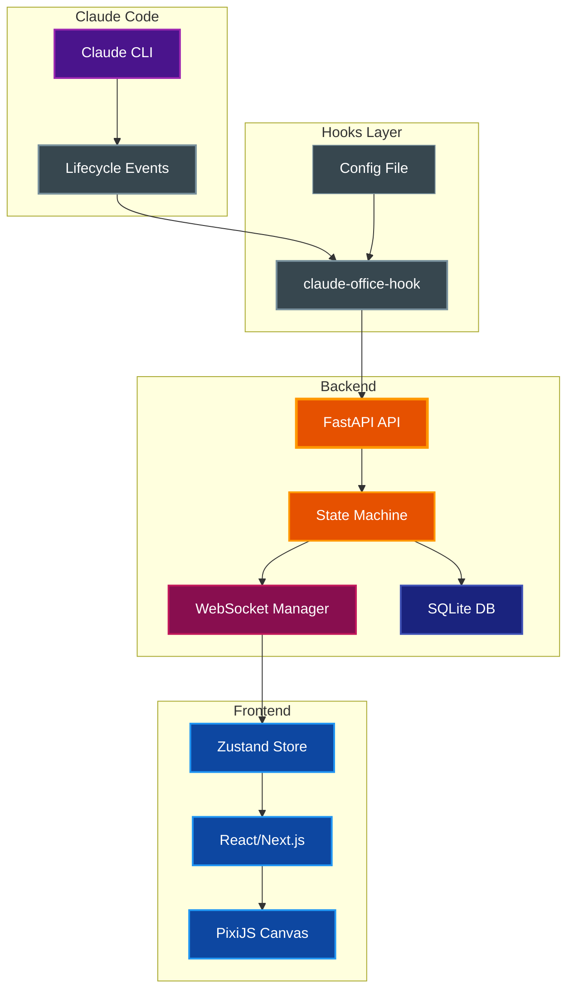
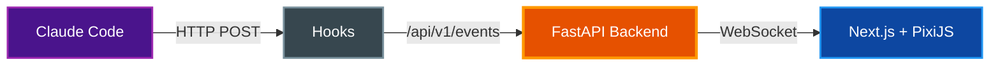
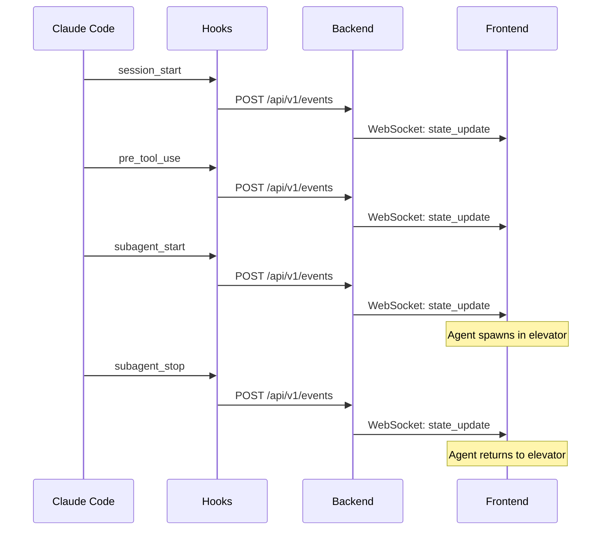
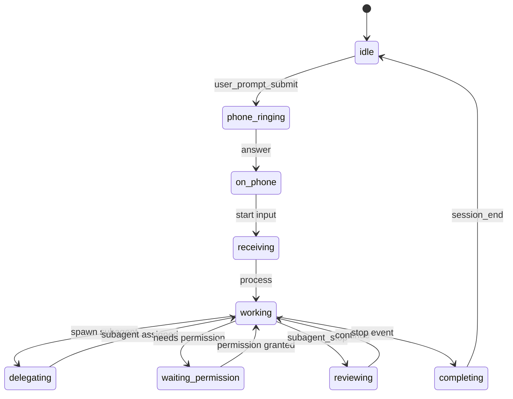
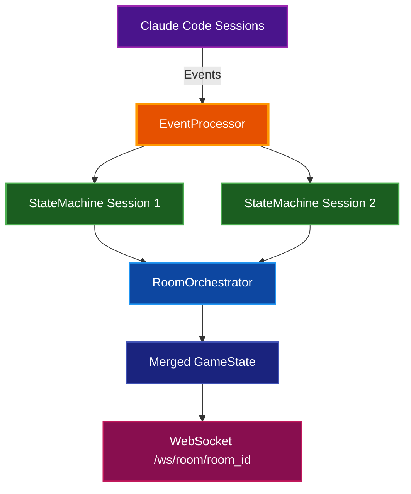
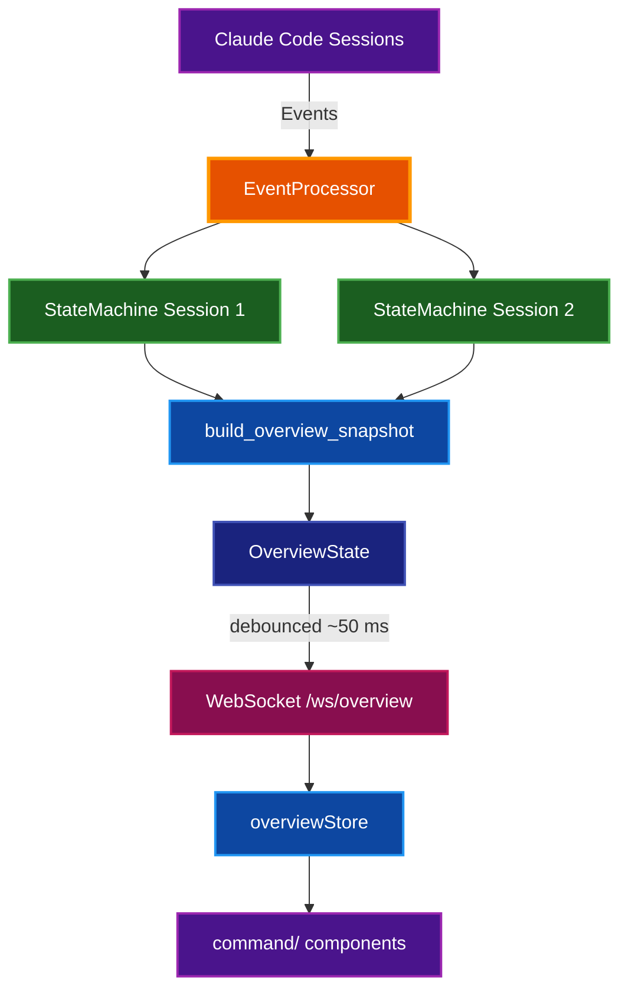
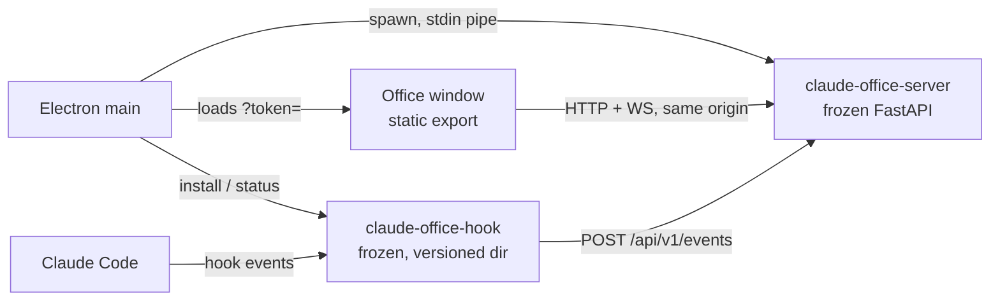

# Architecture

System architecture and design documentation for Claude Office Visualizer.

## Table of Contents

- [Overview](#overview)
- [System Architecture](#system-architecture)
- [Data Flow](#data-flow)
- [Components](#components)
- [Event System](#event-system)
- [Subagent Lifecycle](#subagent-lifecycle)
- [Mid-Session Joining](#mid-session-joining)
- [Frontend State Management](#frontend-state-management)
- [Boss State Machine](#boss-state-machine)
- [Work Acceptance Quotes](#work-acceptance-quotes)
- [Work Completion Quotes](#work-completion-quotes)
- [Beads Issue Tracker Integration](#beads-issue-tracker-integration)
- [Context Compaction Animation](#context-compaction-animation)
- [Printer Animation](#printer-animation)
- [City Skyline Window](#city-skyline-window)
- [Wall Clock](#wall-clock)
- [User Preferences](#user-preferences)
- [Internationalization](#internationalization)
- [3D World (Babylon.js)](#3d-world-babylonjs)
- [PixiJS Rendering](#pixijs-rendering)
- [Multi-Floor / Agent Teams](#multi-floor--agent-teams)
- [Command Center](#command-center)
- [Configuration Reference](#configuration-reference)
- [Related Documentation](#related-documentation)

## Overview

Claude Office Visualizer transforms Claude Code operations into a real-time pixel art office simulation. A "boss" character (main Claude agent) manages work, spawns "employee" agents (subagents), and orchestrates tasks visually.

**Design Principle:** The backend is the source of truth. The frontend is a "dumb" renderer that displays whatever state it receives via WebSocket.

## System Architecture



## Data Flow



**Flow sequence:**
1. Claude Code hooks capture lifecycle events (tool use, subagent spawning)
2. Hooks POST events to backend API
3. Backend state machine transforms events into game state changes
4. State updates broadcast to frontend via WebSocket
5. Frontend renders state using PixiJS

## Components

### Backend (`backend/app/`)

| File | Purpose |
|------|---------|
| `core/state_machine.py` | Transforms CLI events into game state; manages agent lifecycle, desk assignments, animations |
| `core/event_processor.py` | Routes incoming events to state machine, persists to DB |
| `core/handlers/agent_handler.py` | Agent-specific event handling logic |
| `core/handlers/conversation_handler.py` | Conversation history management |
| `core/handlers/session_handler.py` | Session lifecycle event handling |
| `core/handlers/tool_handler.py` | Tool use event handling |
| `core/summary_service.py` | AI-powered summarization for agent tasks and prompts |
| `core/transcript_poller.py` | Polls Claude Code JSONL transcript files for token usage |
| `core/jsonl_parser.py` | Parses Claude Code JSONL transcript format |
| `core/quotes.py` | Quote generation for boss completion messages |
| `core/office_layout.py` | Desk and position constants |
| `core/path_utils.py` | Path utilities for transcript file handling |
| `core/task_persistence.py` | Task list persistence from TodoWrite tool |
| `core/task_file_poller.py` | Polls external task files for todo list updates |
| `core/beads_poller.py` | Polls beads issue tracker for task list integration |
| `core/broadcast_service.py` | Service for broadcasting state updates to WebSocket clients |
| `core/whiteboard_tracker.py` | Tracks whiteboard data (tool usage, agent lifespans, etc.) |
| `core/floor_config.py` | Building/floor/room configuration models for multi-floor navigation |
| `core/product_mapper.py` | Maps sessions to floors/rooms based on repo/project name resolution |
| `core/room_orchestrator.py` | Merges multiple session states into a single GameState for team views |
| `core/token_tracker.py` | Token usage tracking from JSONL transcripts, tool-use counting, thinking-block extraction |
| `core/handlers/team_handler.py` | Event handlers for Agent Teams (task_created, task_completed, teammate_idle) |
| `core/constants.py` | Shared constants |
| `core/logging.py` | Logging configuration |
| `api/websocket.py` | Connection manager for broadcasting state updates |
| `api/routes/events.py` | Event ingestion API endpoint |
| `api/routes/sessions.py` | Session management API endpoints |
| `api/routes/preferences.py` | User preferences API endpoints |
| `api/routes/floors.py` | Building/floor configuration API endpoint |
| `services/git_service.py` | Git repository status service |
| `db/database.py` | SQLite database connection and initialization |
| `db/models.py` | SQLAlchemy database models |
| `models/agents.py` | Agent, Boss, Office state models |
| `models/events.py` | Event and EventData models |
| `models/sessions.py` | GameState and session models |
| `models/common.py` | Shared models (BubbleContent, SpeechContent, TodoItem) |
| `models/git.py` | Git status models |
| `models/ui.py` | UI-specific model re-exports |
| `main.py` | FastAPI application entry point |
| `config.py` | Application configuration |

### Frontend (`frontend/src/`)

| File | Purpose |
|------|---------|
| `components/game/OfficeGame.tsx` | Main PixiJS canvas, renders boss, agents, office |
| `components/game/OfficeBackground.tsx` | Office floor, walls, and static decor |
| `components/game/BossSprite.tsx` | Boss character with typing animation and MobileBoss for compaction |
| `components/game/AgentSprite.tsx` | Agent characters with walk/idle/typing animations |
| `components/game/DeskGrid.tsx` | Agent desk arrangement and positioning |
| `components/game/DeskMarquee.tsx` | Scrolling text marquee for agent task display |
| `components/game/MarqueeText.tsx` | Reusable scrolling text component |
| `components/game/TrashCanSprite.tsx` | Context utilization visualization with stomp effect |
| `components/game/CityWindow.tsx` | City skyline with real-time day/night cycle |
| `components/game/EmployeeOfTheMonth.tsx` | Employee of the Month wall poster |
| `components/game/Whiteboard.tsx` | Multi-mode display with 12 visualization modes |
| `components/game/SafetySign.tsx` | Tool counter since last compaction |
| `components/game/PrinterStation.tsx` | Animated printer for report generation |
| `components/game/Elevator.tsx` | Agent arrival/departure elevator with doors |
| `components/game/WallClock.tsx` | Clickable wall clock (analog/digital modes) |
| `components/game/DigitalClock.tsx` | LED-style digital clock display |
| `components/game/DebugOverlays.tsx` | Development debug visualizations |
| `components/game/LoadingScreen.tsx` | Loading state display |
| `components/game/ZoomControls.tsx` | Canvas zoom controls |
| `components/game/EventLog.tsx` | Event history display panel |
| `components/game/EventDetailModal.tsx` | Modal for viewing event details |
| `components/game/ConversationHistory.tsx` | Conversation history display |
| `components/game/GitStatusPanel.tsx` | Git repository status display |
| `components/game/AgentStatus.tsx` | Agent status indicators |
| `components/game/city/buildingRenderer.ts` | City building rendering with lit windows |
| `components/game/city/skyRenderer.ts` | Sky gradient and celestial body rendering |
| `components/game/city/timeUtils.ts` | Time period calculations for day/night cycle |
| `components/game/whiteboard/*.tsx` | Whiteboard mode components (12 modes) and mode registry |
| `components/game/shared/drawBubble.ts` | Speech/thought bubble rendering utility |
| `components/game/shared/drawArm.ts` | Clock arm rendering utility |
| `components/game/shared/iconMap.ts` | Tool name to icon mapping |
| `components/layout/HeaderControls.tsx` | Header with session controls |
| `components/layout/RightSidebar.tsx` | Right sidebar container |
| `components/layout/SessionSidebar.tsx` | Session list and switcher |
| `components/layout/MobileDrawer.tsx` | Mobile-friendly drawer component |
| `components/layout/MobileAgentActivity.tsx` | Mobile agent activity display |
| `components/layout/StatusToast.tsx` | Toast notification component |
| `components/attention/CommandBar.tsx` | Fuzzy-search command bar for filtering events |
| `components/attention/AttentionToasts.tsx` | Urgency-based toast notifications for agent events |
| `components/attention/AgentPopup.tsx` | Popover for focused agent details and terminal access |
| `components/navigation/Breadcrumb.tsx` | Two-level breadcrumb (Building > Floor) for multi-floor navigation |
| `components/navigation/ViewTransition.tsx` | Animated transitions between building/floor/single views |
| `components/views/BuildingView.tsx` | Building overview showing all floors with active sessions |
| `components/views/FloorView.tsx` | Floor-level view with office canvas and sidebars |
| `components/settings/BuildingTab.tsx` | Settings tab for building/floor/room configuration |
| `components/tour/TourOverlay.tsx` | Guided tour orchestrator with step advancement conditions |
| `components/tour/NarratorBar.tsx` | Bottom bar with tour step title, description, and progress |
| `components/tour/PointerRing.tsx` | Animated highlight ring targeting elements by data-tour-id |
| `components/tour/SpotlightDim.tsx` | Dimming overlay with rectangular cutout for targeted element |
| `components/overlay/Modal.tsx` | Base modal component |
| `components/overlay/SettingsModal.tsx` | Settings configuration modal |
| `stores/gameStore.ts` | Unified Zustand store for all game state (includes bubble queue) |
| `stores/preferencesStore.ts` | User preferences store (clock type, format) |
| `stores/attentionStore.ts` | Attention system store for toast/popup focus management |
| `stores/navigationStore.ts` | Navigation state for building/floor/single view modes |
| `stores/tourStore.ts` | Guided tour state and step definitions |
| `systems/compactionAnimation.ts` | Boss stomp animation when context compacts |
| `systems/animationSystem.ts` | Single RAF loop for all movement and timing |
| `systems/pathfinding.ts` | A* pathfinding with navigation grid |
| `systems/astar.ts` | A* algorithm implementation |
| `systems/navigationGrid.ts` | Grid-based navigation obstacles |
| `systems/pathSmoothing.ts` | Path smoothing for natural movement |
| `systems/agentCollision.ts` | Agent collision detection |
| `systems/queuePositions.ts` | Queue position management for arrivals and departures |
| `systems/hmrCleanup.ts` | Hot module replacement cleanup |
| `hooks/useWebSocketEvents.ts` | WebSocket handler with state machine integration |
| `hooks/useOfficeTextures.ts` | Texture loading and caching |
| `hooks/useSessions.ts` | Session listing and management hooks |
| `hooks/useSessionSwitch.ts` | Session switching logic with auto-follow |
| `hooks/useFloorConfig.ts` | Fetches building configuration from the backend |
| `hooks/useFloorSessions.ts` | Filters sessions assigned to a specific floor |
| `hooks/useRoomSessions.ts` | Filters sessions assigned to a specific room |
| `hooks/useDragResize.ts` | Drag-to-resize sidebar panels |
| `hooks/useTranslation.ts` | i18n translation hook |
| `machines/agentArrivalMachine.ts` | XState machine for agent arrival flow |
| `machines/agentDepartureMachine.ts` | XState machine for agent departure flow |
| `machines/agentMachine.ts` | XState machine for agent state management |
| `machines/agentMachineCommon.ts` | Shared agent machine utilities |
| `machines/agentMachineService.ts` | Agent machine service functions |
| `machines/positionHelpers.ts` | Position calculation helpers for agents |
| `machines/queueManager.ts` | Queue management for arrival/departure |
| `types/index.ts` | TypeScript types barrel (re-exports from generated.ts) |
| `types/generated.ts` | Auto-generated types from backend Pydantic models |
| `types/navigation.ts` | Navigation types (ViewMode, BuildingConfig, FloorConfig) |
| `constants/canvas.ts` | Canvas-related constants |
| `constants/positions.ts` | Position constants for game elements |
| `constants/quotes.ts` | Work acceptance and completion quotes |
| `i18n/index.ts` | i18n setup and language loader |
| `i18n/en.ts` | English translations |
| `i18n/es.ts` | Spanish translations |
| `i18n/pt-BR.ts` | Brazilian Portuguese translations |
| `utils/event-type-styles.ts` | Event type to style mapping for event log |
| `utils/bubbleText.ts` | Shared bubble text truncation utilities |
| `components/debug/sprite-debug/*.tsx` | Sprite builder/debug tool (standalone debug page) |

### Hooks (`hooks/src/claude_office_hooks/`)

| File | Purpose |
|------|---------|
| `main.py` | CLI entry point; parses arguments, reads stdin, calls event mapper, POSTs to backend |
| `event_mapper.py` | Maps raw Claude Code hook payloads to structured Event format |
| `config.py` | Configuration loading (environment variables, config file) |
| `debug_logger.py` | Debug logging to file (when CLAUDE_OFFICE_DEBUG=1) |

**Hook Design Principle:** Hooks must stay lightweight and fast. They should only:
- Pass along data already present in the JSON payload from Claude Code
- Perform minimal transformations (e.g., field renaming, timestamp formatting)
- Never read files, parse transcripts, or do heavy processing

If data needs to be extracted from JSONL transcript files (e.g., token usage, thinking blocks), that extraction belongs in the **backend**, not the hooks.

## Event System

### Event Types

Events flow from Claude Code hooks through the backend to the frontend:

| Event Type | Description |
|------------|-------------|
| `session_start` | Claude Code session begins |
| `session_end` | Claude Code session ends |
| `pre_tool_use` | Tool execution starting |
| `post_tool_use` | Tool execution completed |
| `user_prompt_submit` | User submitted a prompt |
| `permission_request` | Claude needs user permission |
| `notification` | System notification from Claude Code |
| `subagent_start` | Task tool spawning a subagent |
| `subagent_info` | Updates agent with native_agent_id and transcript path |
| `subagent_stop` | Subagent completing work |
| `background_task_notification` | Background task completed or failed |
| `agent_update` | Agent state update |
| `context_compaction` | Context window was compacted |
| `stop` | Main agent completing work |
| `cleanup` | Logical removal of agent after departure |
| `reporting` | Agent reporting to boss |
| `walking_to_desk` | Agent walking to desk |
| `waiting` | Agent waiting for work |
| `leaving` | Agent leaving office |
| `error` | Error event |
| `task_created` | Agent Teams: new task assigned to the team |
| `task_completed` | Agent Teams: team task completed |
| `teammate_idle` | Agent Teams: teammate session went idle |

Agent IDs use format `subagent_{tool_use_id}` to correlate start/stop events.

### Event Flow Sequence



## Subagent Lifecycle

### Agent ID Resolution

A subagent appears as `subagent_<tool_use_id>` (from the Agent/Task tool's PreToolUse). Native `SubagentStart`/`SubagentStop` hooks only carry Claude Code's native `agent_id`, and their timing is not reliably tied to any one start, so they cannot be matched by order.

**Correlation key:** the Agent tool's PostToolUse carries both `tool_use_id` and the native `agentId`. `StateMachine.transition` uses it to link `subagent_<tool_use_id>` to its `native_id` (`link_native_agent`), including for background agents (which stay at their desks until the native SubagentStop).

When a `SUBAGENT_STOP` event arrives, `resolve_agent_for_stop()` in `state_machine.py` resolves it by exact match only:
1. **Direct agent_id match** (`subagent_<tool_use_id>`)
2. **Native ID lookup** (agent linked via PostToolUse)

There is no FIFO/positional fallback: an unmatched, duplicate or re-delivered stop is logged and ignored, and never removes a different agent. `SUBAGENT_INFO` events never link agents; they only start transcript polling for an already-linked agent (or synthesise an agent when its start was missed and nothing is waiting to be linked).

### CLEANUP Event Persistence

When an agent is removed, a `CLEANUP` event is persisted with the resolved `agent_id`:

```python
cleanup_data = EventData(agent_id=resolved_agent_id)
await persist_synthetic_event_fn(session_id, EventType.CLEANUP, cleanup_data)
```

This ensures event replay correctly removes agents even when the original `SUBAGENT_STOP` had `agent_id=None`.

## Mid-Session Joining

When a client connects to an active session (or switches sessions), agents appear at their correct positions rather than re-animating from the elevator.

**Backend State:**
```typescript
interface GameState {
  // ... other fields
  arrivalQueue: string[];    // Agent IDs in arrival queue
  departureQueue: string[];  // Agent IDs in departure queue
}
```

**Frontend Position Detection:**
| Condition | Spawn Position |
|-----------|----------------|
| Agent in `arrivalQueue` | Arrival queue slot (A1, A2, etc.) |
| Agent in `departureQueue` | Departure queue slot (D1, D2, etc.) |
| Agent has desk, not in queues | Desk position |
| Otherwise | Elevator spawn |

**Queue Lifecycle:**
1. `SUBAGENT_START` → Agent added to `arrivalQueue`
2. `PRE_TOOL_USE` → Agent removed from `arrivalQueue` (at desk)
3. `SUBAGENT_STOP` → Agent added to `departureQueue`
4. Agent enters elevator → Agent removed from `departureQueue`

**Implementation:**
- `backend/app/models/sessions.py` - GameState includes queue arrays
- `backend/app/core/state_machine.py` - Manages queue membership
- `frontend/src/hooks/useWebSocketEvents.ts` - Detects position on join
- `frontend/src/systems/queuePositions.ts` - Tracks occupied elevator positions

## Frontend State Management

All game state is managed in a single Zustand store (`gameStore.ts`). Use individual selectors to prevent re-render loops:

```typescript
// Good - stable primitive selector
const isConnected = useGameStore((state) => state.isConnected);

// Good - use exported selectors for consistency
const agents = useGameStore(selectAgents);
const boss = useGameStore(selectBoss);

// Bad - returns new object reference every render
const { boss, agents } = useGameStore((state) => ({ boss: state.boss, agents: state.agents }));
```

**Key State Areas:**
- Agent animation state (position, phase, bubbles)
- Boss state (backend state, typing, task)
- Office state (elevator, phone, context utilization)
- Queues (arrival and departure queues)
- UI state (debug overlays, replay)

## Boss State Machine

The boss character has the following internal states (defined in `backend/app/models/agents.py`):

| State | Meaning |
|-------|---------|
| `idle` | Waiting, not doing anything |
| `phone_ringing` | Phone is ringing (incoming user prompt) |
| `on_phone` | Boss is on the phone with user |
| `receiving` | Actively receiving user input |
| `working` | Processing/executing tasks |
| `delegating` | Spawning subagents |
| `waiting_permission` | Waiting for user permission (AskUserQuestion tool) |
| `reviewing` | Reviewing completed work from agents |
| `completing` | Finishing up a task |



**Note:** The compaction animation (boss walking to trash can and jumping) is handled separately in the frontend via `CompactionAnimationPhase` in `gameStore.ts`, not as a boss state. See [Context Compaction Animation](#context-compaction-animation) for details.

## Work Acceptance Quotes

When agents receive work from the boss, they display a random quote from a pool of 100 phrases:

**Categories:** Enthusiastic, Professional, Casual, Motivated, Tech-themed, Office humor

**Implementation:**
- `frontend/src/constants/quotes.ts` - Quote definitions (`WORK_ACCEPTANCE_QUOTES` array)
- Random selection from the array when agent receives work

## Work Completion Quotes

When agents turn in completed work, they display a random quote from a pool of 100 phrases:

**Categories:** Presenting work, Proud, Confident, Casual handoff, Professional, Tech-themed, Playful, Relief, Short

**Implementation:**
- `frontend/src/constants/quotes.ts` - Quote definitions (`WORK_COMPLETION_QUOTES` array)
- `backend/app/core/quotes.py` - Backend quote generation for boss completion messages
- Displayed when agent reaches the departure ready spot

## Beads Issue Tracker Integration

The visualizer can integrate with the [beads](https://github.com/paulrobello/beads) issue tracker CLI. When a session's project root contains a `.beads/` directory, the poller automatically:

1. Detects the presence of `.beads/` on session start
2. Polls `bd query --json` for open/in_progress/blocked issues
3. Converts beads issues to `TodoItem` objects for the task list panel
4. Updates in real-time when issues change status

**Status Mapping:**

| Beads Status | TodoStatus |
|--------------|------------|
| `open` | `pending` |
| `in_progress` | `in_progress` |
| `blocked` | `pending` |
| `deferred` | `pending` |
| `closed` | `completed` |

**Configuration:**

| Environment Variable | Default | Description |
|---------------------|---------|-------------|
| `BEADS_POLL_INTERVAL` | `3.0` | Polling interval in seconds |

**Implementation:**
- `backend/app/core/beads_poller.py` - Poller implementation with hash-based change detection
- `backend/app/core/event_processor.py` - Integration with session lifecycle
- Thread pool execution for non-blocking CLI calls
- WARNING-level logging on first failure, DEBUG for subsequent failures

## Context Compaction Animation

When Claude Code performs context compaction (`context_compaction` event), the boss walks to the trashcan and stomps it empty:

**Animation Phases:**
1. `walking_to_trash` (800ms) - Boss leaves desk and walks to trashcan
2. `jumping` (36 seconds) - Boss jumps 36 times, each stomp reduces context incrementally until 0%
3. `walking_back` (800ms) - Boss returns to desk after context reaches 0%

**Implementation:**
- `systems/compactionAnimation.ts` - Animation state machine hook
- `BossSprite.tsx` - `MobileBoss` component renders boss body during animation
- `TrashCanSprite.tsx` - Squish effect on stomp

## Printer Animation

The printer animation triggers when:
1. The main agent completes (`stop` event, not `subagent_stop`)
2. The user's original prompt requested a report/document

Detection methods:
- **Primary (AI):** Asks Claude "Does this request ask for a report, document, or documentation to be created?"
- **Fallback (keywords):** Matches "report", "documentation", "readme", "architecture", "guide", ".md", or patterns like `create|write|generate|update|add` + `.md`

## City Skyline Window

The city window shows an animated skyline with real-time day/night cycle based on the current season:

**Time Periods (vary by season):**

| Period | Features |
|--------|----------|
| Night  | Stars, moon arc, lit windows (35% lit probability) |
| Dawn   | Rising sun, gradient transition (20% lit probability) |
| Day    | Sun arc, animated drifting clouds, few lit windows (5% lit probability) |
| Dusk   | Setting sun, gradient transition (30% lit probability) |

**Animated Clouds:**
- Two clouds drift slowly across the sky during daytime
- Top cloud moves slower than bottom cloud (parallax effect)
- Clouds are clipped to window bounds using PixiJS mask

**Seasonal Variations:**

| Season | Dawn            | Dusk            |
|--------|-----------------|-----------------|
| Winter | 6:30am - 8:00am | 4:30pm - 6:30pm |
| Spring | 5:30am - 7:00am | 6:00pm - 8:30pm |
| Summer | 4:30am - 6:00am | 7:30pm - 9:30pm |
| Fall   | 6:00am - 7:30am | 5:30pm - 7:30pm |

**Building Lights:**
- Window lit probability varies by time of day
- Session-based seed ensures each session has unique but stable light patterns
- Seed falls back to date-based if no session ID (pattern changes daily)
- Individual lights randomly toggle on/off every 1-3 minutes
- Creates a "living city" effect where occupants come and go
- Toggled state persists and accumulates during session

**Debug:** Press `D` then `T` to fast-forward (full 24-hour cycle in ~12 seconds)

## Wall Clock

The wall clock supports multiple display modes:

| Mode | Description |
|------|-------------|
| Analog | Traditional clock face with hour, minute, and second hands |
| Digital 12h | LED-style display with AM/PM indicator |
| Digital 24h | LED-style display with 24-hour format |

**Interaction:** Click the clock to cycle through modes (analog → digital 12h → digital 24h → analog)

**Persistence:** Clock preferences are stored in the backend database and persist across sessions.

## User Preferences

User preferences are stored in the backend SQLite database as key-value pairs:

| Key | Values | Default | Description |
|-----|--------|---------|-------------|
| `clock_type` | `analog`, `digital` | `analog` | Wall clock display mode |
| `clock_format` | `12h`, `24h` | `12h` | Digital clock time format |
| `auto_follow_new_sessions` | `true`, `false` | `true` | Auto-follow new sessions in the current project |
| `language` | `en`, `es`, `pt-BR` | `en` | UI language for internationalization |

**Auto-Follow New Sessions:**
When enabled (default), the frontend automatically detects new Claude Code sessions in the same project and switches to follow them. Detection is based on matching `projectRoot` paths. This is useful when working in the same repository and starting multiple Claude Code sessions.

**API Endpoints:**
- `GET /api/v1/preferences` - Get all preferences
- `GET /api/v1/preferences/{key}` - Read a single preference
- `PUT /api/v1/preferences/{key}` - Set a preference
- `DELETE /api/v1/preferences/{key}` - Remove a stored preference

**Frontend:** The `preferencesStore.ts` Zustand store manages preference state and syncs with the backend.

## Internationalization

The frontend supports multiple languages via a lightweight i18n system in `frontend/src/i18n/`:

| File | Purpose |
|------|---------|
| `i18n/index.ts` | Locale type, translation loader, and `getTranslation()` factory |
| `i18n/en.ts` | English translations (source of truth) |
| `i18n/es.ts` | Spanish translations |
| `i18n/pt-BR.ts` | Brazilian Portuguese translations |

**Usage:** The `useTranslation` hook provides a `t()` function with parameter interpolation. Translations are key-value; English serves as the fallback for missing keys.

**Adding a language:** Create a new file (e.g., `fr.ts`) with all `TranslationKey` entries, register it in `index.ts`, and add the locale to the `Locale` type.

## 3D World (Babylon.js)

The 3D renderer (`frontend/src/engine/`, mounted by `components/world/WorldCanvas.tsx`) draws the
whole campus as one building: reception and offices on level 0, a control room at the hall end, and
the "software factory" (one production line per repository) on the level below. It is independent of
the PixiJS office above; the renderer preference selects between them. Design background:
[`docs/design/software-factory.md`](../design/software-factory.md); open review items:
[`docs/design/review-plan.md`](../design/review-plan.md).

### Module map

Data flows left to right: layout (pure) -> world (builds and owns Babylon objects) -> screens
(canvas textures) -> fx (lighting and post-processing). `logic/` and `layout/` import no Babylon.

| Directory (`src/engine/`) | Role |
|---|---|
| `contracts.ts` | Hand-written TS mirror of the backend `/ws/campus` schema, plus `BuildingLayout`, `FactoryLayout`, `IWorld` and the event/action ids. Checked against the backend by `tests/contractsDrift.test.ts` |
| `layout/` | Pure geometry: `buildingLayout.ts` (bay grid of project rooms on both sides of the hall), `factoryLayout.ts` (cells, lanes, stairs under the rooms), `exteriorPlan.ts` |
| `logic/` | Framework-free models: `syncDiff.ts` (campus feed -> `SyncOp`s), `factoryModel.ts` (PRs/checks -> lines, lanes, stations, workpieces), `opsModel.ts`, `sessionInfo.ts`, `projectMap.ts`, `status.ts`, `factoryLive.ts` (the model the scene shows, published to the HUD) |
| `world/` | `World.ts` (engine, render loop, sync seam, teleport), `Building.ts`, `EntranceHall.ts`, `ProjectRoom.ts`/`Room.ts`, `ControlRoom.ts`, `Exterior.ts`, `Visibility.ts` (zone/portal culling), and `world/factory/` (instanced pools: `Conveyors`, `Stations`, `Workpieces`, `Cell`, `Dock`, `Truck`, `FactoryHall`) |
| `screens/` | Canvas-textured displays: `ScreenHub`/`MonitorBatch` (live planes only near the player), `opsCanvas.ts` (control-room wall), `DoorSign`, `Whiteboard`, `ProjectInfoScreen`, `LabelLayer`. Strings go through `@/i18n` (`setOpsLocale` for the wall) |
| `fx/` | `Lighting` (HDRI probes, baked-once shadows), `PostFx` (G-buffer, SSAO, SSR, DoF, AA), `fxPlan.ts` (tier -> render plan), `graphicsSettings.ts` (presets), `Quality.ts` (auto governor) |
| `materials/`, `assets/` | PBR surfaces (`Materials.ts`, `assets/materials2.ts`), glTF models and characters (`AssetLibrary`, `manifest.ts`), procedural fallbacks |
| `player/`, `input/`, `interaction/`, `physics/` | First/third-person and fly camera, key bindings, F/Enter targets and actions, Havok colliders |
| `characters/`, `art/`, `util/` | Rigs and poses, procedural geometry, `MeshBatcher` |

HUD (React) lives in `components/world/hud/` and talks to the engine only through `IWorld` events and
the stores (`worldUiStore`, `campusStore`).

### Sync pipeline

1. Backend: `build_campus()` -> `/ws/campus` (see the `/ws/campus` section) carries sessions, stats and the
   per-repository CI/PR `projects` list (polled by `core/ci_poller.py`, last-good data with
   `stale`/`error`).
2. Frontend: `hooks/useCampusWebSocket.ts` (reconnect with backoff + jitter, no retry on 4003, slow
   retry on 4013) -> `stores/campusStore.ts`.
3. `WorldCanvas` subscribes to the store and calls `world.sync(input)`:
   `allocateSlots` -> `generateLayout` -> `diffCampus` (`syncDiff.ts`, O(n)) -> apply ops (rooms,
   actors, screens) -> `applyToModel`.
4. Factory: `world/factory/factorySync.ts` builds a `FactoryModel` from the projects (with the
   previous model for lane stability) and only touches the instanced buffers when `factoryKey`
   changes; an empty feed renders empty cells, never demo PRs. The result is published through
   `logic/factoryLive.ts` so the HUD panels read what the scene shows.
5. Demo mode: `engine/demo/` generates a campus (and `demoFactory`) when no live feed is used.

### Quality tiers

`fx/graphicsSettings.ts` defines the presets `auto | low | medium | high | ultra | custom`; touching
any individual field turns the preset into `custom`. In `auto`, `fx/Quality.ts` walks
high -> medium -> low from the frame time (2 s mean over 24 ms steps down, at most once per 3 s; under
12 ms for 20 s steps up). `fx/fxPlan.ts` maps the tier to the render plan (post-process chain,
shadow/SSAO/SSR quality, resolution scale); `GraphicsController` applies it. Screens release their
textures at far LOD and redraw only when their content key changes.

### Debug pages and URL parameters

All debug pages are Next routes under `src/app/` and are meant for screenshots and measurement.

| Route | Purpose |
|---|---|
| `/world-debug` | The full 3D world on the demo campus (or `live=1` for the real feed) |
| `/actors-debug` | Characters in every pose, a walking actor, monitors and labels |
| `/materials-debug` | Contact sheet of every `materials2` candidate |
| `/factory-debug/{cell,conveyors,dock,panels,workpieces}` | Isolated factory sandboxes |
| `/sprite-debug` | Pixi sprite tooling |

`/world-debug` query parameters (full list in the header of `app/world-debug/page.tsx`):

| Parameter | Effect |
|---|---|
| `n=6`, `t=20000`, `demoFactory=1`, `live=1` | Demo session count, frozen demo clock, demo factory data, real backend feed |
| `quality=auto\|high\|medium\|low`, `gfx=<preset>`, `gfxset=key:value,...`, `tierStep=low@60,high@120` | Force a tier or a single setting; replay a live tier change |
| `cam=x,y,z,yawDeg,pitchDeg`, `tp=1` | Fixed eye pose (freezes the player); third person |
| `walk=x,y,z,yawDeg;x,z;...` | Scripted walk with the real player collider (progress in `__worldStats.walk`) |
| `inspect=1`, `panel=1`, `ops=1` | Simulate F inspect (DoF), open the first factory panel, show the Ops dashboard |
| `shot=1`, `frames=40` | Set `document.title = "ready"` after N frames so scripts know when to capture |
| `drawdbg=1` | Per-pass draw breakdown in `__worldStats.passes` |
| `brand=`, `brandTag=`, `brandColor=`, `brandFlicker=1` | Lobby sign branding |

`window.__worldStats` (refreshed every 500 ms) exposes `draws`, `active`, `textures`, `zone`,
`actors`, `factory` and, when reported, `postProcesses`, `screenUploads` and `textureMB`.

### Screenshot, walk-test and perf workflow

- Never launch a browser by hand. Screenshots go through the serialising wrapper
  `~/.local/share/claude-office-shot/shot.sh "<url>" <out.png> [frames] [w] [h]` against the running
  dev server on `:3000` (it uses at most two browser slots and kills the browser afterwards); keep
  results under `~/.local/share/claude-office-shot/out/<topic>/`.
- Reference views use `/world-debug?...&shot=1&cam=...`; compare PNGs by eye or pixel diff.
- `make perf-gate` checks draw-call budgets at the reference cameras; `make walk-gate` runs scripted
  collider walks (`walk=`) and asserts they end on the right floor. Both go through `shot.sh` and the
  machine-wide heavy lock (`.heavy.lock`).
- Heavy commands (`bun run build`, Blender) run under
  `flock ~/.local/share/claude-office-shot/.heavy.lock <cmd>`; vitest uses `--maxWorkers=4`.
- Dead-code gate: `bun run knip` (part of `make checkall`) fails on unused exports and types.

### Assets

`frontend/public/assets/` is git-ignored except `NOTICE.md`. `bun run assets` (`scripts/fetch-assets.ts`)
downloads the Poly Haven models and HDRIs listed in `engine/assets/manifest.ts`; `bun run materials`
builds the ambientCG PBR sets (`materials2/`); `bun run characters` converts the character packs. The
runtime tolerates missing files (procedural fallbacks).

## PixiJS Rendering

### Sharp Text at 2x

For crisp text rendering in PixiJS, render text at 2x size and scale down:

```tsx
// Render at 2x fontSize, scale container to 0.5
<pixiContainer scale={0.5}>
  <pixiText
    text="Sharp text"
    style={{ fontSize: 24 }}  // 2x the desired 12px size
    resolution={2}
  />
</pixiContainer>
```

This produces sharper text than rendering at native size. Apply to all in-scene text (labels, bubbles, UI elements).

### Sprite Art Style

- 45-degree front/top-down perspective (NOT isometric)
- Magenta (#FF00FF) chroma key background for transparency
- 16-bit retro pixel art aesthetic
- Tintable items rendered WHITE/GRAYSCALE for runtime color variation

## Multi-Floor / Agent Teams

When `CLAUDE_CODE_EXPERIMENTAL_AGENT_TEAMS=1` is enabled, Claude Code can run multiple sessions that collaborate as a team. The visualizer maps each team session onto a floor/room model so multiple sessions render as a single shared office view.

### Components

| File | Purpose |
|------|---------|
| `backend/app/core/floor_config.py` | Pydantic models (`BuildingConfig`, `FloorConfig`, `RoomConfig`) that define which projects belong to which floors and rooms. Configuration is stored as JSON in the `user_preferences` table under the key `building_config`, or loaded from `floors.toml` for development. |
| `backend/app/core/room_orchestrator.py` | `RoomOrchestrator` merges multiple session `StateMachine` instances into a single `GameState`. Solo sessions (one session, no `team_name`) pass through unchanged. Team sessions get lead/teammate/subagent character allocation and a merged kanban board. |
| `backend/app/core/handlers/team_handler.py` | Handlers for `task_created`, `task_completed`, and `teammate_idle` events. These are fired by Claude Code Agent Teams and add logging and room-level notifications alongside the state machine transitions. |

### Data Flow



**Flow sequence:**

1. Multiple Claude Code sessions (a lead plus teammates) send events to the same backend
2. `EventProcessor` creates one `StateMachine` per session and resolves floor/room assignment via `ProductMapper` and `BuildingConfig`
3. After processing each event, the `EventProcessor` updates the `RoomOrchestrator` for the session's room
4. The `RoomOrchestrator` merges all session states into a single `GameState` with lead and teammate characters
5. The merged state is broadcast to room-level WebSocket connections

### Team Event Types

Agent Teams emit three additional event types:

| Event Type | Description | State Machine Effect |
|------------|-------------|---------------------|
| `task_created` | A new task is assigned to the team | Creates a `KanbanTask` entry on the whiteboard |
| `task_completed` | A team task is completed | Updates the `KanbanTask` status to `completed` |
| `teammate_idle` | A teammate session goes idle | Sets the teammate's boss state to `IDLE` |

### Team Character Mapping

The `RoomOrchestrator` maps each teammate's `BossState` to an `AgentState` for character rendering:

| BossState | AgentState (Teammate Rendering) |
|-----------|--------------------------------|
| `IDLE` | `IDLE` |
| `PHONE_RINGING` | `WAITING` |
| `ON_PHONE` | `WORKING` |
| `RECEIVING` | `THINKING` |
| `WORKING` | `WORKING` |
| `DELEGATING` | `WORKING` |
| `WAITING_PERMISSION` | `WAITING_PERMISSION` |
| `REVIEWING` | `WORKING` |
| `COMPLETING` | `COMPLETED` |

Teammates are assigned colors in order of arrival: blue, green, purple, orange, pink, teal. The lead is always gold (`#f59e0b`).

### Floor Configuration

Floors can be configured via a `floors.toml` file in the backend directory or through the preferences API. Each floor has a name, floor number, accent color, icon, and a list of rooms (repos).

```toml
[[floors]]
id = "engineering"
name = "Engineering"
floor_number = 1
accent = "#6366f1"
icon = "office"

[[floors.rooms]]
id = "main-app"
repo_name = "my-application"
```

### API Endpoints

| Method | Path | Description |
|--------|------|-------------|
| `GET` | `/api/v1/floors` | Return the current building/floor configuration |

### WebSocket

| Path | Description |
|------|-------------|
| `/ws/room/{room_id}` | Real-time state updates for all sessions in a room (team view) |

The room WebSocket broadcasts the merged `GameState` from the `RoomOrchestrator`. Frontend clients connect to this endpoint instead of the session-level `/ws/{session_id}` when viewing a team session.

## Command Center

The Command Center is a cross-session overview: a single pixel office that gathers the boss (main agent) of every live session into one room, so you can see at a glance which terminals need you, which are working, and which are done. It is reachable from the header (when two or more sessions are active) or from the Building view's penthouse tile.

### Components

| File | Purpose |
|------|---------|
| `backend/app/models/overview.py` | `OverviewBucket = Literal["needs_you", "working", "done"]`, `OverviewEntry` (per-session: `session_id`, `bucket`, `state`, `current_task`, `todo_done`, `todo_total`, `subagent_count`), and `OverviewState` (`entries`, `last_updated`). The "ended" bucket is derived frontend-side, not sent by the backend. |
| `backend/app/core/room_orchestrator.py` | `build_overview(sessions) -> OverviewState` buckets each live session into `needs_you` / `working` / `done`. |
| `backend/app/core/event_processor.py` | Async `build_overview_snapshot` collects the per-session `StateMachine`s and calls `build_overview()`; `_schedule_overview_broadcast` debounces the broadcast (~50 ms) and is scheduled last in event processing. |
| `frontend/src/stores/overviewStore.ts` | Zustand store holding the raw per-session boss snapshots, connection state, and last-update timestamp from `/ws/overview`. |
| `frontend/src/hooks/useOverviewWebSocket.ts` | Connects to `/ws/overview` only while the Command Center is visible; tears down on unmount. Separate from the session-bound `useWebSocketEvents`. |
| `frontend/src/components/command/CommandCenterView.tsx` | Top-level Command Center view component. |
| `frontend/src/components/command/CommandCenterCanvas.tsx` | PixiJS canvas for the Command Center room. |
| `frontend/src/components/command/layout.ts` | Open-plan layout: four status columns (Needs-you, Working, Done, Ended) each holding a 2×4 grid of slots. |
| `frontend/src/components/command/CommandCenterBackground.tsx` | Floor and walls, mirroring the office theme. |
| `frontend/src/components/command/CommandCenterDecor.tsx` | Open-plan decor — framed posters on the top wall and a furniture row (plants, printer, water cooler, coffee machine) along the bottom. |
| `frontend/src/components/command/CommandCenterFurniture.tsx` | Desk workstations composed from office sprites for the Needs-you and Working columns. |
| `frontend/src/components/command/CommandCenterZones.tsx` | Renders the status-column zones. |
| `frontend/src/components/command/CommandCenterBoard.tsx` | Top-wall whiteboard showing combined stats across every session: terminal count, per-status counts, total subagents, aggregate todo progress. |
| `frontend/src/components/command/CommandCenterPeer.tsx` | A single session's boss rendered as a peer (body geometry compact relative to the office `BossSprite`). |
| `frontend/src/components/command/ExitingPeer.tsx` | Exit animation body for sessions entering the Ended column (walks to the elevator doorway at the top-centre of the Ended column). |
| `frontend/src/components/command/PeerPopup.tsx` | Popover showing focused-session details. |
| `frontend/src/components/command/sessionMatchesFloor.ts` | Returns whether a session belongs to a configured floor (repo-name match). |
| `frontend/src/components/command/useCommandCenterPeers.ts` | Derives render-ready peers from the overview store, including the linger duration for sessions that end. |
| `frontend/src/systems/commandCenterGrid.ts` | Navigation grid marking static furniture (desks, lounge couches, exit elevator, top wall) as obstacles for A*. |
| `frontend/src/systems/commandCenterMotion.ts` | Walks Command Center agents to their fixed slot positions via the shared A*, self-gating the RAF loop while anything is moving. |
| `frontend/src/systems/exitAnimation.ts` | Lightweight per-frame clock for the Ended column: a finished session's agent walks to the elevator, the doors open, and it fades out. |

### Data Flow



**Flow sequence:**

1. Any processed event schedules an overview broadcast via `_schedule_overview_broadcast`, debounced at roughly 50 ms (a no-op when there are zero watchers).
2. `build_overview_snapshot` collects the per-session `StateMachine`s and calls `build_overview()` to bucket each live session into `needs_you`, `working`, or `done`.
3. The `OverviewState` fans out to at most 16 `/ws/overview` clients.
4. `useOverviewWebSocket` feeds `overviewStore`; the `command/` components render each session as a peer in the Command Center room. The "ended" bucket is derived frontend-side so a session can linger briefly before walking to the elevator.

### WebSocket

| Path | Description |
|------|-------------|
| `/ws/overview` | Cross-session Command Center feed carrying one `OverviewState` per debounced update (max 16 clients) |

The `/ws/overview` endpoint is declared before `/ws/{session_id}` so "overview" is not captured as a session id. On connect the client receives an initial `state_update` snapshot. New connections are refused (close code 4013) once the 16-client cap is reached; disallowed origins close with 4003.

### `/ws/campus`

A second cross-session feed used by the 3D office. It streams one `CampusSession` per live session (boss, agents, office, todos, bucket, `ended`, and the last 8 history entries as `recentActivity` with summaries truncated to 140 chars). History, conversation, and whiteboard data are deliberately excluded. Built by `build_campus()` in `backend/app/models/campus.py`, broadcast by `broadcast_campus_state` after a 100 ms debounce (`_schedule_campus_broadcast`; also scheduled on session removal and task/beads polling), and skipped entirely when nobody is watching. Declared before `/ws/{session_id}`; capped at 8 clients (close 4013), origin check closes with 4003, and a snapshot is sent on connect.

Each `CampusSession` also carries an at-a-glance summary (all optional/nullable in the TS contract):

- `objective` (<= 90 chars): rolling session goal. Precedence: AI summary (`summarize_objective`, run off the hot path once per substantive prompt; stale results dropped), else Claude Code's own `aiTitle` from the transcript, else a heuristic headline (first meaningful sentence of the first substantive prompt, politeness/paths/URLs stripped, word-boundary truncation; trivial prompts such as "yes", "ok", single words and slash-commands are skipped; a follow-up keeps it, a clearly new top-level instruction replaces it). The heuristic is computed in the synchronous state-machine prompt handler, so a DB restore rebuilds it with zero AI calls.
- `sessionName`: the user's `/rename` (`customTitle`). `aiTitle`/`customTitle` are tailed incrementally from the transcript JSONL (`core/session_titles.py`, byte offset per session, last occurrence wins, first read of a large file only reads the tail) whenever an event carries `transcript_path`, live and on restore.
- `focus` (<= 90 chars): boss current task, else the in-progress todo, else the latest tool activity ("Running make checkall", "Editing backend/app/main.py").
- `workItems` (<= 4, each <= 70 chars): in-progress todos, then active subagent tasks as `"<name>: <task>"`, de-duplicated case-insensitively.
- `gitBranch`: read from `.git/HEAD` of the session's project root (`services/git_branch.py`, worktree-aware, cached 30 s, never shells out); null if unknown or detached.

`GET /api/v1/sessions` additionally returns `sessionName` (live sessions only) and a `displayName` that prefers the user label, then `sessionName`, then the stored display name, then the project folder basename, then the short id.

## Desktop App

`desktop/` packages everything as one install per OS (details: [desktop/README.md](../../desktop/README.md)):



- `packaging/` freezes the backend and the hook with PyInstaller (onedir) and smoke-tests them (`make -C packaging all smoke`).
- The backend runs with an explicit `CLAUDE_OFFICE_API_KEY`. Only `/api/v1` is gated, so the static UI still loads, and the key reaches the UI through the `?token=` intake. `--exit-on-stdin-close` stops the server when the shell dies.
- Hooks are managed by the hook binary itself: `claude-office-hook install|uninstall|status`. The desktop app registers an absolute path in a versioned per-user directory and re-points it on update.
- **WSL bridge** (Windows): Linux hooks inside WSL distros tag `data.wsl_distro`. `core/wsl_bridge.py` maps their transcript paths to `\\wsl.localhost\<distro>\…` at intake, before persistence. These sessions' liveness uses staleness instead of the Windows pid registry.

## Configuration Reference

All configuration is managed via environment variables or a `.env` file in the `backend/` directory.

| Variable | Default | Description |
|----------|---------|-------------|
| `DATABASE_URL` | `sqlite+aiosqlite:///<backend dir>/visualizer.db` | Database connection string (absolute path; `docker-compose` overrides to `/app/data/visualizer.db`) |
| `GIT_POLL_INTERVAL` | `5` | Git status polling interval in seconds |
| `CLAUDE_CODE_OAUTH_TOKEN` | (empty) | OAuth token for AI summaries via Claude API |
| `SUMMARY_ENABLED` | `True` | Enable or disable AI-powered summaries |
| `SUMMARY_MODEL` | `claude-haiku-4-5-20251001` | Claude model used for summary generation |
| `SUMMARY_MAX_TOKENS` | `1000` | Maximum tokens for summary API responses |
| `CLAUDE_PATH_HOST` | (empty) | Host path prefix for Docker volume translation |
| `CLAUDE_PATH_CONTAINER` | (empty) | Container path prefix for Docker volume translation |
| `BEADS_POLL_INTERVAL` | `3.0` | Beads issue tracker polling interval in seconds |
| `EVENT_RATE_LIMIT` | `300` | Max event POSTs accepted per 60 s window (global, shared across all sessions) |
| `ZOMBIE_SUBAGENT_TIMEOUT_SECONDS` | `90` | Seconds of transcript inactivity before a subagent is assumed crashed and a synthetic `SubagentStop` is emitted to clean it up |
| `CLAUDE_OFFICE_API_KEY` | (empty — auto-generated per launch) | Explicit API key; when set, gates all state-changing endpoints via `X-API-Key` (see [Authentication](#authentication)) |
| `SERVE_STATIC` | (unset) | Set to `1`/`true`/`yes` to serve the built frontend from `backend/static/` |
| `BACKEND_CORS_ORIGINS` | localhost origins | Allowed CORS origins (localhost only by default) |
| `CLAUDE_OFFICE_DATA_DIR` | (empty) | Writable state dir; the DB and `telemetry_state.json` default into it (explicit `DATABASE_URL`/`TELEMETRY_STATE_PATH` win). Set by the desktop app |
| `CLAUDE_OFFICE_STATIC_DIR` | (empty → `backend/static/`) | Frontend export served when `SERVE_STATIC` is on. Set by the desktop app |
| `CLAUDE_OFFICE_WSL_BRIDGE` | (auto: on for Windows) | Translate `data.wsl_distro` events' transcript paths to `\\wsl.localhost\…`; override for tests |

**Docker path translation:** When running in Docker, set both `CLAUDE_PATH_HOST` and `CLAUDE_PATH_CONTAINER` so the backend can translate transcript file paths from the host to the container filesystem. For example, `CLAUDE_PATH_HOST=/Users/username/.claude` and `CLAUDE_PATH_CONTAINER=/claude-data`.

### Authentication

The backend has a two-mode API-key model. When `CLAUDE_OFFICE_API_KEY` is unset (the default), a random token is generated per launch and only the destructive global operations (`DELETE /api/v1/sessions`, `POST /api/v1/sessions/simulate`) require it. When `CLAUDE_OFFICE_API_KEY` is set explicitly, every endpoint except `/health`, `/docs`, `/redoc`, the OpenAPI schema, and CORS preflight requires the key in the `X-API-Key` header (compared with `hmac.compare_digest`). Browser WebSocket connections must originate from an allowed localhost origin; non-browser clients must send `X-API-Key` or the handshake closes with code 4003. See the [backend README](../../backend/README.md#authentication) for the full key sources, gated endpoints, and discovery flow.

## Related Documentation

- [README.md](../../README.md) - Project overview and quick start
- [CLAUDE.md](../../CLAUDE.md) - AI assistant instructions and commands
- [Whiteboard Modes](../reference/whiteboard-modes.md) - Whiteboard multi-mode display documentation
- [Claude Code JSONL Format](../research/claude-code-jsonl-format.md) - Transcript file format research
