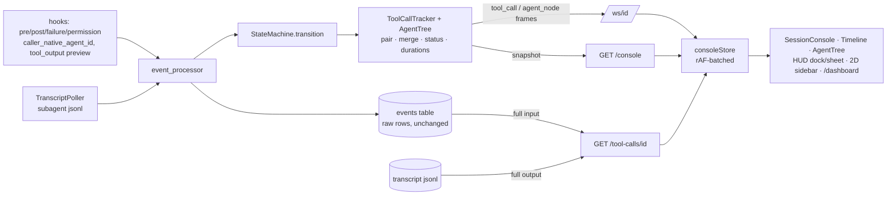
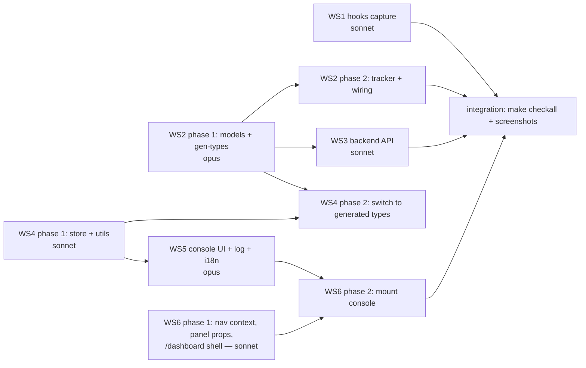

# Session Console and Dashboards: UX upgrade spec

This spec redesigns how Claude Office shows what a session is doing. It covers a per-session **Session Console**, a redesigned **event timeline** (which replaces today's event log and tool-use UI), a clear **main agent / subagent** distinction, and a **`/dashboard` route** that mounts the same panels without WebGL. It also lists the minimal backend and hook changes these need, and splits the work into six workstreams with exclusive file ownership.

The user request this answers:

> "I think the event log / tool use UI could be drastically improved. Also, I don't see the difference between main agent and sub agents. In the ops view when I click on a session it just opens the event/tool use ui, I think we should see more than that. I should be able to get all the details I need on what's happening in the game, without having to leave it and go to claude UI. Also all those UI views should be available in the claude office game, outside of the 3D view as well (same dashboards, etc)"

File references use `path:line` against commit `0621b9c` (branch `feat/3d-office`). They go stale as the code changes; re-grep before you rely on a line number.

## Table of Contents

- [1. Findings](#1-findings)
- [2. UX spec](#2-ux-spec)
- [3. Data and API changes](#3-data-and-api-changes)
- [4. Workstreams](#4-workstreams)
- [5. Open questions and risks](#5-open-questions-and-risks)

---

## 1. Findings

### 1.1 Event log and tool-use UI today

**What the event log renders** (`frontend/src/components/layout/EventLog.tsx`):

- One row per raw hook event, newest first: time, `[EVENT TYPE]`, `@agentId.slice(0, 8)…`, and a one-line summary (`EventLog.tsx:52-94`). The text is 10–11 px.
- Clicking a row opens `EventDetailModal` (`components/game/EventDetailModal.tsx:86-185`). The modal shows the fields that happen to be in `detail`. `toolInput` is a raw `JSON.stringify` dump (`:176-184`). The modal has no output, no diff, no duration and no linked events.
- The row key is `` `${event.id}-${index}` `` (`EventLog.tsx:54`). New entries are *prepended* (`stores/slices/officeSlice.ts:106`), so every index shifts and all 500 rows re-key and remount on each event. The list is not virtualized.
- A tool call shows up as two unrelated rows, `Using Bash <target>` and `Completed Bash` (`backend/app/core/event_processor.py:1620-1633`). The two rows are never paired, and there is no duration. A permission request is a third row, `Waiting for permission: Bash`, with no resolution.

**Where the log data comes from:**

- `eventLog` is filled **only** from live `event` frames (`hooks/useWebSocketEvents.ts:114-116` → `officeSlice.ts:99-107`). It is cleared on every session switch (`stores/gameStore.ts:313`).
- The backend also sends `history` (up to 500 entries with `detail`) inside **every** `state_update` (`core/broadcast_service.py:45-50`, `core/state_machine.py:817`). **No frontend code reads `state.history`** (grep finds no consumer). So after a session switch the log says "Waiting for events…" until the next event arrives, even though the data was already sent. Meanwhile every event re-sends the full GameState, including 500 history entries with raw `toolInput` dicts and 500 conversation entries.
- On restore from the DB, history entries are rebuilt with `"detail": {}` (`event_processor.py:1195`). Even if the frontend read `history`, a restored session would have no detail.
- The `detail` dict carries only `toolName, toolInput, resultSummary, message, thinking, errorType, taskDescription, agentName, prompt` (`event_processor.py:667-681`). It has no `tool_use_id`, no `success`, no `native_agent_id` and no timing.

**What the hooks capture versus drop** (`hooks/src/claude_office_hooks/event_mapper.py`):

| Data | Captured? | Evidence |
|---|---|---|
| Tool name and full `tool_input` | Yes (pre and post) | `event_mapper.py:112-113, 145-146` |
| `tool_use_id` | Yes, on every tool hook | `event_mapper.py:355-356` |
| **Tool output (`tool_response`)** | **No.** Only read for Task/Agent, and there `data["result"]` (`:186`) is not a model field, so `extra="ignore"` drops it (`backend/app/models/events.py` `ToolEventData`) | `event_mapper.py:161-188` |
| **Success / error** | **Hard-coded `True`** (`:147`). `PostToolUseFailure` is not registered (`hooks/manage_hooks.py:12-23`) | local DB: 259/259 `post_tool_use` rows have `success=1`. `result_summary`, `error_type` and `thinking` are null in **every** row |
| **User prompt** | **Truncated to 50 chars** in the hook (`event_mapper.py:286-288`). The conversation "user" turn *is* that stub | local DB: prompt lengths are 50, 50, 1 |
| Which agent ran the tool | **Forced to `"main"`** for every non-Task tool event (`event_mapper.py:135, 197`) and for permission requests (`:296`) | see 1.2 |
| Assistant text | Only the final reply per turn, read from the transcript at `stop` (`core/handlers/conversation_handler.py:137-176`). The main agent's intermediate text and thinking are never captured (no hook sets `thinking`, and only subagent transcripts are polled) | `core/transcript_poller.py` |

Subagent tool calls also come from `TranscriptPoller`, which tails `subagents/agent-<id>.jsonl` and synthesizes `pre_tool_use` / `post_tool_use` with `agent_id=subagent_<toolu>`. Its post event carries `success = not is_error`, but **no output** (`transcript_poller.py:265-307`).

The hook POST timeout is **0.5 s** (`hooks/src/claude_office_hooks/config.py:85`), and the local hooks log already shows `TimeoutError`s. So large payloads must not go through the hook. Full outputs should be read **on demand from the transcript**, which already holds every `tool_result` keyed by `tool_use_id`.

### 1.2 Main agent versus subagents

**How they are represented in the data:**

- The main agent is `agent_id="main"`, the boss (`models/agents.py` `Boss`). A subagent is `agent_id="subagent_<tool_use_id of the Task/Agent call>"` (`event_mapper.py:117, 183`), with `native_id` linked from the Task `PostToolUse` response (`core/state_machine.py:374-381`). `Agent.parent_id` exists but is only set for Agent Teams (`models/agents.py`).
- The id encodes the spawning call, so **a tree is derivable**: main → Task call `toolu_X` → subagent `subagent_toolu_X` → that subagent's tool calls (poller events) → result (`subagent_stop`, or the Task post result).

**Where the distinction is lost:**

1. **Every subagent tool call is recorded twice, and the first copy says "main".** The hook fires `PreToolUse`/`PostToolUse` for tools inside subagents too, and the mapper stamps them `agent_id="main"`. The poller then emits the same `tool_use_id` again under the subagent id. There is no dedupe: both copies are persisted (`event_processor.py:589`), appended to history (`:692`) and broadcast (`:737`). In the local `backend/visualizer.db`, **every one** of the 38 subagent `pre_tool_use` rows has a `main` twin with the same `tool_use_id`. The side effects:
   - The boss animates "working" with the subagent's tool bubble (`state_machine.py:269-292`).
   - `tool_calls` telemetry is double-counted (`core/telemetry.py:306-311`).
   - Campus `recent_activity` (`models/campus.py:239`) is polluted.
2. **Labels are unreadable.** `@{agentId.slice(0, 8)}…` renders `@subagent…` for *every* subagent (`EventLog.tsx:76-80`). `ConversationHistory.tsx:204-206` renders `@subagent_to` for every subagent.
3. **No hierarchy anywhere in the UI.** `AgentStatus.tsx` lists subagents only (no main row, no parent, no task-call link). Nested agents are flat. The poller drops nested `Task` but not `Agent` (`transcript_poller.py:273`), so an `Agent` call inside a subagent becomes a plain tool row, and the hook's `subagent_start` creates an unparented sibling.

### 1.3 What the ops view session click does

- Clicking a row calls `onEnter(sessionId)` (`hud/ops/OpsDashboard.tsx:309`). `OpsOverlay` closes ops and calls `enterSession(id)` (`hud/ops/OpsOverlay.tsx:32-35`).
- `enterSession` (`components/world/enterSession.ts:29-47`) teleports into the room, runs `setPanels(["events", "conversation"])` (`:36`), flashes a banner, and selects the session. **That is all.** The user lands in the 3D room with the two weakest panels open. Because of 1.1, the events panel is usually empty right after the switch.
- The hover-only "Inspect" button (`OpsDashboard.tsx:334-348`) opens `InspectPanel` (`OpsOverlay.tsx:36-39`). That panel shows the boss task, an agent list, todos and the last **8** activity lines (`RECENT_ACTIVITY_LIMIT = 8`, `models/campus.py:49`). It is the closest thing to a console today, but it is built on the slim campus feed.
- F on a room monitor calls `openInspect` (`components/world/WorldCanvas.tsx:181-182`). F on the ops wall calls `openOps` (`:179-180`).
- HUD docking: 420 px wide on the right in landscape, or a **45 % bottom sheet** in portrait, with at most 2 panels (`components/world/WorldHud.tsx:198-209`, `stores/worldUiStore.ts:117`). The user's 1820×2020 monitor matches `(orientation: portrait)`, so they get the bottom sheet.

### 1.4 Content parity (3D HUD versus 2D)

| Panel / dashboard | 3D HUD | 2D pixel | Data source | 3D coupling to remove for sharing |
|---|---|---|---|---|
| Ops dashboard + charts + project map | B anywhere, F on ops wall | — | `campusStore` | Root is an overlay dialog (`OpsDashboard.tsx:73-77`). Otherwise prop-driven; `OpsOverlay` is the connected wrapper |
| Factory Line / PR / Station / Deploy | F on factory objects | — | `useFactoryData` (falls back to `campusStore` without a world) | Target read from `worldUiStore.factoryTarget` (`hud/factory/useFactoryData.ts:43`). `app/factory-debug/panels` already mounts them with no world |
| InspectPanel | F on room monitor | — | `campusStore` | `worldUiStore.inspectTarget` (`InspectPanel.tsx:55`), `enterSession` (`:164`) |
| SessionsPanel (Tab), OverviewStrip | yes | — (2D has `SessionSidebar`) | `campusStore` + sessions | `enterSession` (`SessionsPanel.tsx:91`, `OverviewStrip.tsx:176-192`) |
| Minimap | M | — | `worldUiStore.layout/pose` | Inherently 3D (teleport via `getWorld`, `Minimap.tsx:119-123`). **Not ported**; `OpsProjectMap` covers the overview |
| EventLog, ConversationHistory, GitStatusPanel, AgentStatus | L, C, G, T | `RightSidebar` | `gameStore` (selected session only) | none (already shared) |
| Whiteboard modes (tool pizza, timeline, heat map, remote workers, …) | — | inside the Pixi canvas | `whiteboardData` | Pixi-rendered, not DOM. Follow-up (see 5) |
| CommandCenter, Building/Floor views | — | yes | sessions, floors | Pixi; out of scope |

Two more constraints:

- **The campus socket is only mounted by `WorldView`** (`components/world/WorldView.tsx:62`), so pixel mode has no campus data and could not render the ops dashboard even if it were mounted.
- Header controls are desktop-only (`app/page.tsx:438-451`). Mobile has only `MobileDrawer`.

Everything these panels import from `engine/` (`engine/contracts.ts`, `engine/logic/{opsModel,factoryLive,factoryModel,statusPalette,projectMap}.ts`, `engine/layout/factoryLayout.ts`) has **zero** `@babylonjs` imports. `worldRef.ts` imports only types. So sharing is a matter of injecting targets and navigation, not of untangling the renderer.

**Header data already exists.** `CampusSession.telemetry` provides model, effort, `context_used_pct`, `cost_usd`, lines added/removed and `duration_ms` (`models/telemetry.py:26-44`). `CampusSession` also carries `phase`, `git_branch` and `alive`, and `CampusProject.prs` carries PR/CI data.

### 1.5 Infrastructure facts the design relies on

- `/ws/{id}` sends the current `state_update` and `git_status` on connect (`api/routes/websockets.py:156-181`). `git_service.remove_session` is **not ref-counted** (`services/git_service.py:332-336`, called on every disconnect at `websockets.py:186-187`). A second socket for the same session would stop git updates for the first when it closes.
- Static export: `/dashboard` is served as `dashboard.html` through the backend's SPA fallback (`backend/app/main.py:318-329`). `utils/api.ts` reads a `token` query parameter, which must be preserved on navigation.
- No virtualization or syntax-highlighting library is installed (`frontend/package.json`). `react-markdown` + `remark-gfm` are available.
- Engine-owned keys: WASD/arrows, Space, V, N, F, R, Enter (`engine/input/bindings.ts`). HUD keys: Tab, G, C, L, T, M, O, H, B. **Free:** I, J, K, P, Q, E, U, X, Y, Z.

---

## 2. UX spec

### 2.1 Principles

1. **One call, one row.** A tool call is a single row whose state changes from running to waiting to ok, error or denied. Pre, post and permission events merge into it. Duration is shown on the row.
2. **The agent is always visible.** Every row carries its agent's colour rail and icon. Subagent work nests under the Task call that spawned it.
3. **Chronological, newest at the bottom, live-follow by default**, like a terminal. This applies to the console, the L panel and the conversation.
4. **Previews stream, full payloads load on demand.** The list never carries megabytes.
5. **The same components everywhere:** HUD dock, full-screen sheet, 2D sidebar and `/dashboard`.

### 2.2 Visual language

- **Surfaces.** Reuse `GLASS` and `LABEL` from `components/world/hud/glass.ts` for HUD presentations, and the ops `CARD` style (`rounded-2xl border-white/[0.08] bg-[#0B111B]/90`, `OpsDashboard.tsx:55-56`) for page and sheet presentations. Use a dark theme only.
- **Type.** Body 13 px, meta 12 px, nothing below 12 px (today's log uses 10–11 px). Use monospace for targets, inputs and outputs. At the user's 1820×2020 monitor this fits about 60 timeline rows; at 390 px, about 14.
- **Agent identity:**
  - Main agent: brand orange `#F97316` (the header "Claude" colour), `Crown` icon, label "Main agent".
  - Subagent: the backend-assigned `Agent.color`, `Bot` icon, label = `agent_name` (the Task description), an `agent_type` chip (`Explore`, `general-purpose`, …), and a short native id (`a5a60c7`) on hover.
  - Teammate (Agent Teams): `Users` icon, violet chip.
  - Background Bash task: `Timer` icon, slate.
  - The colour shows as a 3 px left rail on every row the agent owns. Indent is 16 px per depth level.
- **Status colours** (shared with ops `STATUS_COLORS` semantics):

  | State | Colour | Glyph |
  |---|---|---|
  | running | sky-400, pulsing dot (static under reduced motion) | ◌ |
  | waiting for permission | amber-400 row tint (same amber as ops "needs you") | ⏸ |
  | ok | emerald-400 | ✓ |
  | error | rose-400 glyph, `bg-rose-500/10` tint and a rose rail overlay | ✗ |
  | denied (inferred) | slate-500, struck-through target | ⊘ |
  | interrupted | slate-400 | ■ |

- **Tool icons** (lucide):

  | Tool | Icon |
  |---|---|
  | Read | `FileText` |
  | Edit / MultiEdit / Write | `FilePen` |
  | Bash / BashOutput | `Terminal` |
  | Grep / Glob | `Search` |
  | WebFetch / WebSearch | `Globe` |
  | Task / Agent | `Bot` |
  | TodoWrite | `ListChecks` |
  | `mcp__*` | `Plug` (with server name chip) |
  | other | `Wrench` |

- **Payload rendering** (in-house, no heavy deps). `utils/console/tokenize.ts` handles JSON, shell and diff tokens. `lineDiff.ts` is an LCS line diff, capped at 2000 lines per side, with a "show full" fallback. Read output gets line numbers and a language label from the file extension, but no grammar highlighting.

### 2.3 Session Console layout

The same `SessionConsole` component has three presentations:

| Presentation | Where | Size |
|---|---|---|
| `sheet` | Over ops (B), from the 2D sidebar, `/dashboard?tab=console` | Full viewport under the HUD/header (like `OpsDashboard`) |
| `dock` | 3D HUD panel `console` (I key, Enter room, F on room monitor) | Landscape: right dock `clamp(560px, 46vw, 980px)`. Portrait: bottom sheet at **62 %** height (about 1250 px on the user's monitor). Exclusive: opening it closes other docked panels |
| `compact` | The L panel and the 2D sidebar Events tab | Timeline only, 420 px |

Inner layout is chosen by the container width (`ResizeObserver`), not the viewport:

- **≥ 1280 px:** three columns: agent tree (280 px) | timeline (flex) | right pane (min 480 px) with tabs `Detail · Chat · Todos · Git/PR`.
- **800–1279 px:** two columns: timeline | right pane. The agent tree collapses to a horizontal agent chip bar above the timeline.
- **< 800 px:** one column with tabs `Timeline · Agents · Chat · Todos · Git`. Selecting a row pushes a full-height detail view with a back arrow.

#### Desktop wireframe (sheet, 1820 px wide)

```text
┌─ SESSION CONSOLE ───────────────────────────────────────────────────────────────────────────────────────────────┐
│ ● claude-office  ⎇ feat/3d-office  [WORKING · editing · 2m]   opus · high   $3.42   412k tok   ctx ▓▓▓▓▓▓░░ 64%  │
│   ⏱ 1h12m   +812 −95   PR #57 ✓ checks 12/12 ↗                       [Enter room] [Open in 3D|Dashboard] [⎘] [✕]  │
├──────────────────────┬───────────────────────────────────────────────────────┬──────────────────────────────────┤
│ AGENTS        3 · 1◌ │ ⌕ search…  /   [Agent: all ▾] [Read][Edit][Bash][Search] │ DETAIL │ CHAT │ TODOS │ GIT/PR   │
│                      │ [Web][Agent][MCP]   [⚠ 2 errors] [⏸ 0 waiting] [Tree|Flat]│                                  │
│ ♛ Main agent      ◌  │───────────────────────────────────────────────────────│ ✎ Edit  frontend/src/stores/     │
│   Edit consoleStore… │ 14:01:58 ▶ You  "I think the event log / tool use UI…"  │   consoleStore.ts                 │
│ ├ ◆ Audit hook…   ◌  │ 14:02:03 ♛ ⌕ Grep   "agent_id" hooks/src        0.1s ✓ │ Main agent · 14:02:11 · 0.4s ✓   │
│ │   Explore · 23 · 3m│ 14:02:11 ♛ ✎ Edit   stores/consoleStore.ts +12 −3 0.4s✓│ ─────────────────────────────── │
│ │ └ ◆ Check Sub…  ✓  │ 14:02:15 ♛ $ Bash   bun run test -- --maxWo…    12s ◌ │  41   const MAX = 500;            │
│ │     general · 4    │ 14:02:40 ♛ ◆ Agent  "Audit hook payloads" · Explore  ▾ │ -42   calls: [] as ToolCall[],    │
│ ├ ◆ Review UI…    ✓  │  ┃ 14:02:42 ◆ ⌕ Grep  "tool_response"           0.1s ✓ │ +42   calls: new Map<string,      │
│ │   Plan · 51 · 6m   │  ┃ 14:02:44 ◆ 📄 Read  event_mapper.py:100-310  0.0s ✓ │ +43     ToolCall>(),             │
│ └ ⏲ bg: bun run b… ◌ │  ┃ 14:03:02 ◆ $ Bash  uv run pytest -q   exit 1 4.1s ✗ │  44   order: [] as string[],      │
│                      │  ┃          └ FAILED test_mapper.py::test_prompt …    │ ─────────────────────────────── │
│                      │  ┗ ↩ result "The hook forces agent_id=main for…" 3m12s│ [Copy input] [Copy output]        │
│ filter: click a node │ 14:05:30 ♛ ⏸ $ Bash git push origin feat/3d…  waiting 38s│ [Open full ↗] [Copy path]         │
│                      │ 14:09:40 ◀ Claude "Done. I wrote docs/design/…"  ⏹ turn│                                  │
│                      │                                    [⏸ Paused · 12 new ↓]│                                  │
└──────────────────────┴───────────────────────────────────────────────────────┴──────────────────────────────────┘
```

#### Mobile wireframe (390 px)

```text
┌──────────────────────────────┐      ┌──────────────────────────────┐
│ ←  claude-office          ⋯  │      │ ←  Bash · Main agent      ⎘  │
│ ⎇ feat/3d  [WORKING 2m]  ●   │      │ 14:03:02 · 4.1s · exit 1 ✗   │
│ $3.42 · ctx 64% · 1h12m      │      │ ──────────────────────────── │
│ ┌Timeline┬Agents┬Chat┬Todo┬Git│      │ $ uv run pytest -q           │
│ ⌕ search…        [Filters 2] │      │ ──────── stdout ──────────── │
│ ──────────────────────────── │      │ ....F.....                   │
│ 14:02 ♛ ✎ Edit consoleSt… ✓ │      │ FAILED test_mapper.py::te…   │
│ 14:02 ♛ $ Bash bun run t…  ◌ │      │ AssertionError: expected …   │
│ 14:02 ♛ ◆ Audit hook…    ▾  │      │ ──────── stderr ──────────── │
│  ┃ 14:02 ◆ ⌕ Grep "tool_… ✓ │      │ (empty)                      │
│  ┃ 14:03 ◆ $ Bash pytest  ✗ │      │                              │
│  ┗ ↩ result …         3m12s │      │ [Copy] [Open full]           │
│ 14:05 ♛ ⏸ $ git push  38s   │      │                              │
│        [⏸ Paused · 12 new ↓] │      │                              │
└──────────────────────────────┘      └──────────────────────────────┘
        timeline tab                          pushed detail view
```

Mobile rows are 44 px tap targets. The filter sheet slides up from the bottom. Swipe-back is not needed; use the arrow button.

#### Header

| Field | Source | Fallback |
|---|---|---|
| Project, branch | `CampusSession.project`, `gitBranch` | `Session.projectName`, `gitStatus.branch` |
| Status pill | `CampusSession.phase` (kind + label + since), with ops colours | `campusStatus()` |
| Model, effort | `telemetry.model`, `effort` | hidden |
| Cost, tokens, context % | `telemetry.costUsd`, `contextTokens`, `contextUsedPct` (gauge in `TONE_COLORS`) | hidden |
| Duration | `telemetry.durationMs`, else now − first event | — |
| +/− lines | `telemetry.linesAdded/Removed` | hidden |
| PR / CI | `CampusProject.prs` matched by `head == gitBranch`. Clicking opens the factory PR panel (3D) or `/dashboard?tab=factory&project=…&pr=…` | hidden |
| Counts | agents (running), calls, errors (click = errors-only filter) | — |

Actions: **Enter room** (3D only, runs today's `enterSession`), **Open in 3D** or **Open in dashboard** (cross-link), **Copy session id**, **Close**.

### 2.4 Agent tree

```text
AGENTS                                   3 agents · 1 running
♛ Main agent                opus      ◌ working            ← orange rail
   ↳ Edit stores/consoleStore.ts                           ← current activity
├─◆ Audit hook payloads     Explore   ◌ running  23 calls  3m12s   ← Agent.color rail
│   ↳ Bash uv run pytest -q
│   └─◆ Check SubagentStop  general   ✓ done      4 calls    40s   ← nested (parent = Audit…)
├─◆ Review UI parity        Plan      ✓ done     51 calls  6m03s
│   ↳ result: "3D-only panels are…"
├─◆ Ghost 9f2c              ?         ✗ zombie    0 calls          ← synthetic stop (poller)
└─⏲ bg: bun run build       Bash      ◌ running                    ← background task
```

- A node shows: icon, name (truncated with a tooltip showing the full task prompt), type chip, state, call count, error count (if > 0), and elapsed time. The second line shows the current activity while running, or a result preview when done.
- **Click** sets the timeline agent filter to that node and its descendants. **Shift+click** adds it to the filter. **Double-click** scrolls the timeline to the spawning Task row.
- Ended subagents stay in the tree for the whole session (dimmed), unlike the 3D office where they leave.
- In `compact` mode the tree is replaced by a chip bar: `[♛ Main] [◆ Audit… ◌] [◆ Review… ✓] [+1]`.

### 2.5 Timeline rows

Each row type has fixed visual states. Collapsed rows are 28 px on desktop and 44 px on mobile. Expanded rows are measured.

```text
STATE              ROW (collapsed)
ok                 14:02:11 ♛ ✎ Edit   stores/consoleStore.ts              +12 −3   0.4s  ✓
running            14:02:15 ♛ $ Bash   bun run test -- --maxWorkers=4                12s  ◌   (elapsed ticks 1 Hz)
waiting perm.      14:05:30 ♛ $ Bash   git push origin feat/3d-office   ⏸ waiting for you 38s  (amber row)
error            ▌ 14:03:02 ◆ $ Bash   uv run pytest -q                  exit 1   4.1s  ✗   (rose tint)
                 ▌          └ FAILED test_mapper.py::test_prompt_full - AssertionError…      (first error line)
denied             14:03:10 ♛ ✎ Write  ~/.bashrc                         denied (inferred)  ⊘
interrupted        14:03:40 ♛ $ Bash   sleep 600                         interrupted 12s  ■
spawn (async)      14:02:40 ♛ ◆ Agent  "Audit hook payloads" · Explore · a5a60c7   ▸ 23 calls 3m12s ◌
marker: prompt     14:01:58 ▶ You    "I think the event log / tool use UI could be drastically…"
marker: reply      14:09:40 ◀ Claude "Done. I wrote docs/design/session-console.md …"   ⏹ turn ended
marker: system     14:10:00 ⟲ Context compacted · 14:11:02 🔔 Notification "Claude needs your permission…"
marker: bg task    14:12:30 ⏲ Background task 3f2a… completed  "build ok"
```

**Expanded row** (inline when there is no Detail column, otherwise the same body renders in the Detail tab). Each tool has a renderer:

```text
▾ 14:02:11 ♛ ✎ Edit  frontend/src/stores/consoleStore.ts                      +12 −3  0.4s ✓
  ┌──────────────────────────────────────────────────────────────────────────────────────┐
  │  41    const MAX = 500;                                                               │
  │ -42    calls: [] as ToolCall[],                                                       │
  │ +42    calls: new Map<string, ToolCall>(),                                            │
  │ +43    order: [] as string[],                                                         │
  └──────────────────────────────────────────────────────────────────────────────────────┘
  [Copy path] [Copy diff] [Open full ↗]                         replace_all: false

▾ 14:03:02 ◆ $ Bash  uv run pytest -q                                       exit 1  4.1s ✗
  $ uv run pytest -q                                   description: "Run hook tests"
  ── stdout (2.0 KB of 18.4 KB · Open full ↗) ────────────────────────────────────────────
  ....F.....
  FAILED tests/test_event_mapper.py::test_prompt_full - AssertionError: …
  ── stderr ── (empty)

▾ 14:02:40 ♛ ◆ Agent "Audit hook payloads" · Explore                        23 calls 3m12s ✓
  prompt (markdown, collapsed to 6 lines) …                                    [show all]
  ┃ … 23 nested rows of the subagent (virtualized with the parent list) …
  ┗ ↩ result (markdown preview) "The hook forces agent_id=main for every …"   [Open full ↗]
```

| Tool | Collapsed target | Expanded body |
|---|---|---|
| Edit / MultiEdit | path + `+a −b` | unified diff of `old_string`/`new_string` (each edit for MultiEdit) |
| Write | path + line count | content preview with line numbers |
| Read | path + `:offset-limit` | output preview (lines) |
| Bash | command (first line) | command, description, stdout/stderr split, exit/interrupt |
| Grep / Glob | pattern + path | input chips + result preview (matches list) |
| WebFetch / WebSearch | URL / query | prompt + result preview (markdown) |
| Task / Agent | description, type, native id | prompt (markdown), nested calls, result |
| TodoWrite | `n todos (k done)` | checklist with changed items highlighted |
| `mcp__srv__tool` | `srv › tool` | JSON tree of input, output preview |
| unknown | first string field | JSON tree |

"Open full" calls `GET /tool-calls/{id}` (section 3.4), shows a spinner, and caches the result per `(callId, rev)`.

**Grouping modes:**

- **Tree** (the default) nests subagent rows under their Task row. Parallel subagents give several open blocks, interleaved by time at block level.
- **Flat** is strictly chronological, with rails and indent still showing ownership.

Both modes flatten to one virtualized row list through the pure function `flattenVisible(calls, agents, expanded, filters, mode)`.

**Filters:**

- agent (multi-select)
- tool kind (Read / Edit / Bash / Search / Web / Agent / MCP / other)
- errors only
- waiting only
- free-text search over tool name, target, input preview and output preview (case-insensitive, 150 ms debounce)

When a filter hides a Task row's children, the Task row stays visible with a `k hidden` badge. On `/dashboard`, filter state lives in the URL (`&agent=…&tool=…&err=1&q=…`).

**Live-follow versus paused:**

- **Following:** the list stays pinned to the bottom, and new rows animate in (no animation under reduced motion).
- Scrolling up more than 48 px, expanding a row, or selecting a row → **Paused**. A pill `⏸ Paused · N new ↓` appears.
- Clicking the pill, pressing `f`, or scrolling to the bottom → **Following**.
- This logic is a tiny pure state machine (`utils/console/followScroll.ts`), unit-tested.

#### Keyboard

These keys apply while focus is inside the console. The console root has `data-hud-keytrap`, and `useHudKeys` ignores everything except Esc while focus is inside it.

| Key | Action |
|---|---|
| `j` / `↓`, `k` / `↑` | next / previous row |
| `Enter` / `→` | expand row (or open Detail tab); on a Task row, expand the block |
| `←` | collapse; on a nested row, jump to its parent Task row |
| `[` / `]` | previous / next error |
| `/` | focus search; `Esc` clears and leaves search |
| `e` | toggle errors-only |
| `a` | cycle agent filter (all → main → each subagent) |
| `t` | toggle Tree / Flat |
| `f` | toggle follow |
| `g` / `G` | top / bottom |
| `c` | copy the selected row's input |
| `o` | open full payload |
| `1`–`5` | right-pane tabs (Detail, Chat, Todos, Git/PR) or mobile tabs |
| `Esc` | close detail → clear selection → close console (sheet returns to ops when opened from ops) |

The list uses `role="listbox"` with `aria-activedescendant`. Rows carry `aria-expanded` and an `aria-label` that names agent, tool, target and status.

### 2.6 Event log redesign (L panel and 2D sidebar)

- The L panel and the 2D `RightSidebar` Events tab become `<Timeline density="compact" sessionId={selected} />`. It uses the same rows, chip-bar agent filter, errors toggle and follow pill, with no tree column and no right pane.
- `Enter` (or a click) on a compact row opens the console **focused on that call**: the dock in 3D, the sheet in 2D.
- `EventDetailModal` is replaced by `ToolCallDetail`, which is rendered in a modal only where no console can open.
- **Fallback:** if the backend lacks the console API (an older backend, so the snapshot returns 404), `EventLog` renders the legacy `gameStore.eventLog` with stable keys and chronological order. That keeps the `eventLog` plumbing in use (knip stays green) and keeps mixed-version setups working.
- `ConversationHistory`:
  - Agent chips use names and colours from the agent tree instead of `@subagent_to`.
  - Adopts the same follow/pause behaviour (today it force-scrolls on every change, `ConversationHistory.tsx:280-283`).
  - "You" prompts render in full now that the hook stops truncating them.
  - It is reused as the console's Chat tab.
- `AgentStatus` (T panel) shows `AgentTree` with the game-state details underneath.

### 2.7 Placement

**3D:**

| Entry | Today | New |
|---|---|---|
| Ops row click (B) | close ops → teleport → events + conversation | console **sheet over ops**, focused on that session. Esc returns to ops. The header's **Enter room** button runs today's flow |
| Ops row hover "Inspect" | InspectPanel | becomes "Console" (same as the click) plus an "Enter room" button |
| `Enter` on a room / character | teleport + events + conversation | teleport + **console dock** |
| F on a room monitor (screen target) | InspectPanel | console dock for that session |
| F on the ops wall | ops | unchanged |
| `I` (new) | — | toggle console dock (the selected session, or the room you stand in) |
| `L` | event log | compact timeline |
| `C`, `T`, `G` | conversation, agents, git | improved components (2.6) |
| InspectPanel | — | superseded. Kept for one release, with an "Open console" button; delete in a follow-up |

The console dock is exclusive (`MAX_OPEN_PANELS` still applies to the others). The HUD frame gains a `wide` variant. `?hud=console` / `?hud=ops` debug query params open these on load so `shot.sh`, which cannot press keys, can screenshot them.

**2D pixel view:**

- The `RightSidebar` Events tab shows the compact timeline. Its "Open console" button opens the console sheet over the canvas.
- The header gets a **Dashboards** button.

**Outside 3D: the `/dashboard` route** (`app/dashboard/page.tsx`, static export → `dashboard.html`):

```text
DESKTOP (1820×2020)
┌ Claude ▸ Dashboards                        [3D] [Pixel] [Dashboards]   ● live · 6 sessions   ⚙  ? ┐
├ [Ops] [Sessions] [Console ▾ claude-office] [Factory ▾ claude-office]                              ┤
│ ┌ OverviewStrip ── ● claude-office WORKING · ● api-server NEEDS YOU · ○ docs IDLE · …  ───────────┐ │
│ └────────────────────────────────────────────────────────────────────────────────────────────────┘ │
│  tab = Ops:      <OpsDashboard variant="page">  (alerts, sessions board, project map, usage,      │
│                   activity, ticker). Row click → Console tab for that session                      │
│  tab = Sessions: <SessionsPanel> full width + filters (status/project). Click → Console           │
│  tab = Console:  <SessionConsole presentation="sheet" sessionId=…> (2.3 layout)                   │
│  tab = Factory:  project picker · <LinePanel> | <PrPanel> | <StationPanel> | <DeployPanel>        │
│                   in a responsive grid, with explicit targets (no worldUiStore)                    │
└────────────────────────────────────────────────────────────────────────────────────────────────────┘

MOBILE (390)
┌──────────────────────────────┐
│ ☰  Dashboards       ● live   │
│ [Ops][Sessions][Console][Fac…]  ← horizontally scrollable tabs
│ ● claude-office  WORKING ›   │  ← OverviewStrip collapses to a pill carousel
│ ┌ Needs you (1) ───────────┐ │
│ │ api-server  ⏸ Bash perm. │ │
│ └──────────────────────────┘ │
│ … ops cards stacked (the     │
│   existing portrait layout)  │
└──────────────────────────────┘
```

- URL contract: `/dashboard?tab=ops|sessions|console|factory&session=<id>&project=<id>&pr=<n>&call=<tool_use_id>&agent=…&tool=…&err=1&q=…`. The `token` param is preserved on every link.
- The page mounts `useCampusWebSocket({ enabled: true })`, `useSessions()` and a `SessionNavProvider` (2.8). It must not import Babylon or Pixi; a test walks the import graph.
- No version badge in the dashboard header. A new hard-coded version would add an eighth location to the CLAUDE.md version table.
- Entry points:
  - The `HeaderControls` renderer switch gains a third segment, `Dashboards`.
  - `MobileDrawer` gets a Dashboards item.
  - The ops dashboard and console headers link across ("Open in dashboard" / "Open in 3D").
  - "Open in 3D" navigates to `/` and selects the session through the existing session-switch path.

### 2.8 How panels are shared

- **Pattern:** a presentational component with props, plus a thin connected wrapper per host. Files stay where they are; no moves, to avoid conflicts.
- **`SessionNavContext`** (`components/shared/sessionNav.tsx`) supplies `{ openConsole(id, opts?), enterRoom?(id), openFactory?(target) }`:
  - `WorldHud` provides the 3D implementation (dock/sheet, `enterSession`, `openFactory`).
  - `DashboardShell` provides URL navigation.
  - The 2D page provides "open sheet".
  - `SessionsPanel`, `OverviewStrip`, `InspectPanel` and `OpsDashboard` call the context instead of importing `enterSession` directly.
- `OpsDashboard` gets `variant: "overlay" | "page"`. `page` drops the `absolute inset-0 z-40` dialog root and the close button.
- `useFactoryData(target?)` takes an explicit target and falls back to `worldUiStore.factoryTarget`. The four factory panels accept an optional `target` prop.

---

## 3. Data and API changes

All changes are additive. Old hooks talking to a new backend, and a new hook talking to an old backend, both keep working (`extra="ignore"` on every payload model; new fields are optional).

### 3.1 Hook payload (`hooks/src/claude_office_hooks`)

| Field (event) | Change |
|---|---|
| `caller_native_agent_id`, `caller_agent_type` (pre/post tool use, permission request) | Copy raw `agent_id` / `agent_type` when Claude Code includes them (hooks fired inside a subagent). **Not** `native_agent_id`, which on Task/Agent post already means the *spawned* child (`event_mapper.py:172, 187`). Keep `agent_id="main"` for old backends |
| `tool_output` (post) | Normalized text preview of `tool_response`, capped at **4096 chars** (see 3.1.1) |
| `tool_output_bytes`, `tool_output_truncated` (post) | Original size; truncation flag |
| `success`, `error_message` (post) | Register **`PostToolUseFailure`** → emit `post_tool_use` with `success=false`, `error_message` from the payload's `error`. Keep `success=true` for `PostToolUse` |
| `interrupted` (post) | From `tool_response.interrupted` (Bash) when present |
| `prompt` (user prompt submit) | Send the **full** prompt, capped at 16 KB, plus `prompt_truncated`. Keep `summary` short (unchanged) |
| `tool_use_id` (permission request) | Already passed through when present (`:355`). Add a test |

Verify at implementation time that the installed Claude Code includes `agent_id` in subagent tool hooks. Run with `CLAUDE_OFFICE_DEBUG=1`, which logs the raw input. If it does not, the backend dedupe (3.2) still fixes attribution, about 1 s late.

#### 3.1.1 `tool_output` normalization

| Tool | Preview text |
|---|---|
| Bash | `stdout`, then `\n--- stderr ---\n` + `stderr` if non-empty |
| Read | `file.content` |
| Edit / Write | empty (the input already carries the diff); `filePath` only |
| Grep / Glob | `filenames` joined, or `content` |
| WebFetch | `result` |
| Agent/Task | text blocks of `content` |
| other | `json.dumps(tool_response)[:cap]` |

Keep the total POST body under 24 KB so the 0.5 s timeout holds.

### 3.2 Backend ingest: `ToolCallTracker` and `AgentTree`

New `backend/app/core/tool_calls.py`. A `StateMachine` owns one tracker, and the tracker is fed from `sm.transition(event)`. Because of that, **live, restore and replay all rebuild it identically**, which also fixes the `detail: {}` restore loss.

Rules:

1. **Key** = `tool_use_id`. When it is missing (old producers), use a synthetic `evt-<seq>` that pairs pre→post by `(agent, tool_name)` FIFO.
2. **Merge duplicates.** The first event creates the call; a later event with the same id merges into it:
   - The more specific agent wins (`subagent_*` over `main`).
   - The earliest `started_at` wins.
   - The input is taken from whichever event has it.
   - On post: `error` if any source says `success=false`; `tool_output` from the hook.
   - `apply()` returns `created | updated | merged_duplicate`.
3. **Attribution.** A tool event with `caller_native_agent_id` resolves to the subagent whose `native_id` matches (via the existing `link_native_agent`). The **state machine** then routes it to that agent instead of the boss. This fixes the boss animating subagent work (`state_machine.py:269-292`).
4. **Status:**
   - pre → `running`
   - permission request → `waiting_permission` (matched by `tool_use_id`, else the latest running call of the same agent and tool), with `permission_requested_at`
   - post ok → `ok`
   - post with `success=false` → `error`
   - post with `interrupted` → `interrupted`
   - a call still waiting when the same agent's next pre or `stop` arrives → `denied` (inferred)
   - Task/Agent post with an async `agentId` → `spawned`, until the child's `subagent_stop`, then `ok`
5. **Durations:** `duration_ms = ended_at − started_at`. `permission_wait_ms = post time − permission_requested_at`; this is an upper bound, and the UI labels it "waited ≤".
6. **Agent tree:**
   - `main` is the root.
   - `subagent_start` creates a node with `spawn_tool_use_id` = the suffix of the id.
   - The parent is the agent that owns the spawning call in the tracker; `main` if unknown. It is re-resolved and re-broadcast when a merge reveals the true owner, which fixes nested agents appearing flat.
   - The poller treats `Agent` like `Task` (`transcript_poller.py:273`).
   - Synthetic zombie stops mark the node `zombie`.
   - Background tasks (`BACKGROUND_TASK_NOTIFICATION`) become leaf nodes of kind `background`.
7. **Processor wiring** (`event_processor.py`):
   - Persist as today (the raw event row is kept).
   - **If `merged_duplicate`:** skip `history.append`, `broadcast_event` and `telemetry.record_event`. This removes the doubled log rows and the doubled `tool_calls`.
   - **Always** broadcast the upserted call and any touched agent node (3.5).
8. **Memory:** keep the last 5000 calls per session (preview-only). Older calls come from the DB through the snapshot endpoint's `before_seq` paging, by replaying the event rows.
9. **Slim `state_update.history`:** cap it at the last 50 entries with `detail` reduced to `{toolName}`. No frontend reads it (1.1). `CampusSession.recent_activity` keeps reading the server-side list, and replay is unaffected. Add a payload-size regression test.

### 3.3 New models (`backend/app/models/console.py`)

All models use camelCase aliases like the rest of `models/`, and all are registered in `scripts/gen_types.py` `MODELS`. Run `make gen-types`; `backend/tests/test_gen_types_completeness.py` fails if a model is missed. The frontend `tests/contractsDrift.test.ts` must stay green.

```python
ToolCallStatus = Literal["running", "waiting_permission", "ok", "error", "denied", "interrupted", "spawned"]
AgentKind = Literal["main", "subagent", "teammate", "background"]

class ToolCall(BaseModel):          # streamed; previews only
    id: str                         # tool_use_id or "evt-<seq>"
    seq: int                        # per-session monotonic (ordering + paging cursor)
    rev: int                        # bumps on every update (client drops stale frames)
    agent_id: str                   # "main" | "subagent_<toolu>" | ...
    tool_name: str
    kind: str | None                # PhaseKind via classify_tool()
    target: str | None              # short label: path / command / pattern / url (≤ 200 chars)
    input_preview: dict[str, Any] | None   # each string value ≤ 2 KB, total ≤ 8 KB
    input_truncated: bool = False
    output_preview: str | None      # ≤ 2 KB
    output_bytes: int | None = None
    output_truncated: bool = False
    error: str | None = None        # error_message or first stderr/assertion line
    status: ToolCallStatus
    started_at: str
    ended_at: str | None = None
    duration_ms: int | None = None
    permission_requested_at: str | None = None
    permission_wait_ms: int | None = None
    spawned_agent_id: str | None = None    # Task/Agent calls

class AgentNode(BaseModel):
    id: str; native_id: str | None; parent_id: str | None   # None only for main
    kind: AgentKind; name: str; agent_type: str | None
    color: str | None; task_preview: str | None             # ≤ 1 KB
    state: str; started_at: str | None; ended_at: str | None
    spawn_tool_use_id: str | None; result_preview: str | None
    tool_calls: int = 0; errors: int = 0; current_activity: str | None
    rev: int

class ConsoleHeader(BaseModel):     # assembled from CampusSession + telemetry + sessions row
    session_id: str; project: str | None; branch: str | None; phase: SessionPhase | None
    alive: bool | None; ended: bool; started_at: str | None; last_event_at: str | None
    telemetry: SessionTelemetry | None

class ConsoleSnapshot(BaseModel):
    header: ConsoleHeader
    agents: list[AgentNode]
    tool_calls: list[ToolCall]      # latest `limit` (default 300), ascending seq
    has_more: bool; oldest_seq: int | None
    conversation: list[ConversationEntry]
    todos: list[TodoItem]

class ToolCallDetail(BaseModel):    # on demand only, never streamed
    call: ToolCall
    input: dict[str, Any] | None    # full, from the persisted event row
    output: str | None              # full, ≤ 256 KB
    output_source: Literal["transcript", "hook", "none"]
    output_truncated: bool
```

`ToolEventData` and `PromptEventData` (and the legacy `EventData`) gain the optional fields from 3.1.

### 3.4 REST endpoints (`backend/app/api/routes/console.py`)

| Method and path | Returns | Notes |
|---|---|---|
| `GET /api/v1/sessions/{id}/console?limit=300&before_seq=` | `ConsoleSnapshot` | Live sessions from memory. Unknown-in-memory sessions are restored from the DB via the existing restore path. 404 if there are no events |
| `GET /api/v1/sessions/{id}/tool-calls/{tool_use_id}` | `ToolCallDetail` | Full input from the DB row. Full output from the transcript: the main `transcript_path`, or the subagent's `agent_transcript_path`, scanned for the `tool_result` block with that id (`core/transcript_lookup.py`, bounded reverse scan, `is_safe_transcript_path`). Falls back to the hook preview |
| `GET /api/v1/sessions/{id}/tool-calls?agent=&kind=&status=&q=&before_seq=&limit=` | `list[ToolCall]` | Server-side filter/search for long sessions. **Stretch** |

### 3.5 WebSocket frames on `/ws/{id}`

Both frames are additive; the current frontend `switch` ignores unknown types.

```json
{ "type": "tool_call",  "timestamp": "…", "sessionId": "…", "toolCall": { /* ToolCall */ } }
{ "type": "agent_node", "timestamp": "…", "sessionId": "…", "agent":    { /* AgentNode */ } }
```

- The existing `event` and `state_update` frames are unchanged, except that `history` is slimmed.
- `git_service` configure/remove becomes **ref-counted per session**, so the console's second socket (for a non-selected session) cannot stop git updates for the main one.

### 3.6 Frontend data layer

- **`stores/consoleStore.ts`**, keyed by session (LRU of 3):

  ```text
  { calls: Map<id, ToolCall>, order: string[], agents: Map<id, AgentNode>,
    header, conversation, todos, gitStatus, details: Map<id@rev, ToolCallDetail>,
    hasMore, oldestSeq, status }
  ```

  - Frames are queued and flushed **once per animation frame** (every 250 ms while the tab is hidden).
  - A frame with a `rev` at or below the stored one is dropped.
  - Unchanged calls keep object identity, so `useConsoleCall(id)` re-renders only that row.
- **`hooks/useSessionConsole(sessionId)`**:
  - Fetches the snapshot.
  - Selected session: consumes `tool_call` / `agent_node` frames forwarded by `useWebSocketEvents`; no extra socket.
  - Any other session: opens its own `/ws/{id}` and reads `tool_call`, `agent_node`, `git_status`, plus `conversation` and `todos` from `state_update`, compared shallowly by last id and length.
  - Fetches older pages when the list scrolls to the top.
- **Pure helpers** in `utils/console/`:
  - `tree.ts` (`flattenVisible`)
  - `filters.ts` and `search.ts`
  - `toolFormat.ts` (target, `+a −b`, renderer choice per tool)
  - `lineDiff.ts`
  - `tokenize.ts`
  - `followScroll.ts`
- **Virtualization:** `@tanstack/react-virtual`, pinned to an exact version at least two weeks old, with `measureElement` for expanded rows and overscan 8.
- **Running rows** share one 1 Hz ticker (reuse `useNow` from `hud/GlanceParts.tsx`). No per-row intervals.



---

## 4. Workstreams

Six workstreams. Ownership is **exclusive**: no file appears under two workstreams. A file not listed is not to be edited; if you need one, ask the orchestrator. Every workstream:

- runs `make checkall` for its component(s) before committing
- runs vitest as `bun run test -- --maxWorkers=4`
- runs heavy commands under `flock ~/.local/share/claude-office-shot/.heavy.lock …`
- commits on `feat/3d-office` with a private `GIT_INDEX_FILE`

**Do not touch** `frontend/src/engine/world/{stairs,Building,World,buildingVisibility}.ts` or the walk tests; other agents own them.

`scripts/gen_types.py` currently has an **uncommitted** change in the working tree from another agent (a prettier re-format step). WS2 must build on top of it and must not revert it.

### Ordering



- **Wave 1 (t = 0):** WS1, WS2, WS4 phase 1 (against the section 3.3 contract as interim local types), WS6 phase 1.
- **Wave 2 (after WS2 phase 1 commits the models and `generated.ts`):** WS3, WS4 phase 2, WS5. WS5 can start earlier on `/console-debug` fixtures.
- **Wave 3:** WS6 phase 2, once WS5 exports `SessionConsole`, `Timeline` and `AgentTree`.

### WS1: Hooks capture (suggested model: **sonnet**)

**Owns:**

- `hooks/src/claude_office_hooks/event_mapper.py`
- `hooks/src/claude_office_hooks/tool_output.py` (new)
- `hooks/manage_hooks.py`
- `hooks/tests/**`
- `hooks/README.md`

**Work:** section 3.1. Register `PostToolUseFailure` in `HOOK_TYPES` and the matcher list. Map it to `post_tool_use` with `success=false`.

**Depends on:** nothing. The backend ignores the new fields until WS2 lands.

**Acceptance (pytest):**

- A subagent-context `PreToolUse` with raw `agent_id` sets `caller_native_agent_id` and keeps `agent_id == "main"`.
- A Task/Agent `PostToolUse` still sets `native_agent_id` to the child.
- The prompt is full up to 16 KB with `prompt_truncated`; `summary` is unchanged.
- Bash `tool_response` → `tool_output` has stdout + stderr, capped at 4096, with `tool_output_bytes` / `tool_output_truncated`.
- Read, Grep, WebFetch and the unknown-tool fallbacks behave as specified.
- `PostToolUseFailure` → `success is False` + `error_message`.
- A 1 MB `tool_response` gives a payload under 24 KB.
- `permission_request` passes `tool_use_id`.
- `install.sh` / `manage_hooks` install and uninstall the new hook idempotently.
- `make checkall` passes in `hooks/`.

**Screenshots:** none.

### WS2: Backend tool-call tracker, agent tree and slim broadcast (suggested model: **opus**)

**Owns:**

- `backend/app/models/events.py`
- `backend/app/models/console.py` (new)
- `backend/app/core/tool_calls.py` (new)
- `backend/app/core/state_machine.py`
- `backend/app/core/event_processor.py`
- `backend/app/core/broadcast_service.py`
- `backend/app/core/telemetry.py`
- `backend/app/core/transcript_poller.py`
- `backend/app/core/handlers/**`
- `scripts/gen_types.py`
- `frontend/src/types/generated.ts`
- `backend/tests/test_gen_types_completeness.py`
- `backend/tests/test_tool_calls.py` (new)
- existing backend tests broken by these changes, except the git/websocket tests (WS3)

**Work:**

- **Phase 1** (commit first, within the first hour): `models/console.py` + the new optional event fields + `make gen-types`.
- **Phase 2:** sections 3.2 and 3.5 (frames). Expose a read API for WS3: `sm.tool_calls.snapshot(limit, before_seq) -> (list[ToolCall], has_more, oldest_seq)`, `sm.tool_calls.get(id)`, `sm.agent_tree.nodes()`.

**Depends on:** nothing.

**Acceptance (pytest):**

- pre + post → one `ToolCall` with `duration_ms`.
- A hook `main` pre followed by a poller pre with the same `tool_use_id` → one call, `agent_id == subagent_*`, one history entry, `tool_calls` telemetry counted once. Use a sanitized fixture of the real pattern in `visualizer.db`.
- `caller_native_agent_id` routes to the subagent, and the boss state stays put.
- Permission → `waiting_permission` → `ok` with `permission_wait_ms`; an inferred `denied`.
- `success=false` → `error` with an error message.
- Sync and async Agent: `spawned` → `ok` on `subagent_stop`.
- A nested subagent gets the correct `parent_id` after a merge.
- Zombie stop → node `zombie`.
- **A restored-from-DB machine has a tracker equal to the live one**: same ids, statuses and agents.
- The `state_update` JSON for a 500-event session with 8 KB inputs is at least 70 % smaller than before (record the before/after sizes in the commit message).
- `make gen-types` is clean and the completeness test passes.
- `make checkall` passes in `backend/`.

**Screenshots:** none.

### WS3: Backend console API, transcript lookup and socket safety (suggested model: **sonnet**)

**Owns:**

- `backend/app/api/routes/console.py` (new)
- `backend/app/core/transcript_lookup.py` (new)
- `backend/app/main.py` (one `include_router` line)
- `backend/app/services/git_service.py`
- `backend/app/api/routes/websockets.py`
- `backend/tests/test_console_api.py` (new)
- `backend/tests/test_transcript_lookup.py` (new)
- existing git service and websocket tests

**Work:** section 3.4 (the snapshot and detail endpoints; the filter endpoint is a stretch goal) and ref-counted `git_service` configure/remove.

**Depends on:** WS2 phase 1 (models). It needs WS2 phase 2's read API for live data; until then, stub against `ToolCallTracker` signatures.

**Acceptance (pytest):**

- Snapshot works for a live session, a DB-only session (restored) and an unknown session (404).
- `before_seq` paging is contiguous, with no gaps or duplicates.
- Detail returns the full output from a main transcript and from a subagent transcript (fixture jsonl).
- 256 KB cap with `output_truncated`; `output_source` is correct.
- A path outside the allowed roots → 403 or 404, and nothing is read.
- Two sockets on one session: close one, and the other still receives `git_status`.
- The OpenAPI schema lists the new models.
- `make checkall` passes in `backend/`.

**Screenshots:** none.

### WS4: Frontend console data layer (suggested model: **sonnet**)

**Owns:**

- `frontend/src/stores/consoleStore.ts` (new)
- `frontend/src/hooks/useSessionConsole.ts` (new)
- `frontend/src/hooks/useWebSocketEvents.ts`
- `frontend/src/types/index.ts`
- `frontend/src/utils/consoleApi.ts` (new)
- `frontend/src/utils/console/**` (new)
- `frontend/src/components/console/fixtures.ts` (new; consumed by WS5)
- `frontend/tests/console*.test.ts`, `lineDiff.test.ts`, `followScroll.test.ts`, `toolFormat.test.ts` (new)

**Work:** section 3.6, apart from virtualization (WS5) and UI.

- **Phase 1:** the store API, the utils, and fixtures that cover a long session (5000 calls), errors, permission, nested agents and a re-attribution merge.
- **Phase 2:** switch to the `generated.ts` types; the snapshot and websocket wiring.

**Depends on:** WS2 phase 1 for phase 2 only.

**Acceptance (vitest):**

- 200 frames in one tick → one store notification.
- An unchanged call keeps referential identity.
- A stale `rev` is ignored.
- A snapshot/live race: a frame that arrives before the snapshot resolves is applied after it.
- Re-attribution moves the row under the subagent in `flattenVisible`.
- Tree and Flat flattening with collapse; a filter that hides children keeps the parent with a hidden count.
- Search matches target, input and output previews.
- `lineDiff` handles add, remove, replace and the cap.
- `toolFormat` covers every tool in the 2.5 table.
- `followScroll` transitions are correct.
- LRU eviction at 3 sessions.
- No second socket opens when `sessionId` equals the selected session.
- `make checkall` passes in `frontend/`.

**Screenshots:** none.

### WS5: Session Console UI, timeline and event log redesign, i18n (suggested model: **opus**)

**Owns:**

- `frontend/src/components/console/**` (new: `SessionConsole`, `ConsoleHeader`, `AgentTree`, `Timeline`, `TimelineRow`, `ToolCallDetail`, renderers, `ConsoleFilters`, `FollowPill`, `theme.ts`). Excludes `fixtures.ts`, which belongs to WS4.
- `frontend/src/components/layout/EventLog.tsx`
- `frontend/src/components/layout/ConversationHistory.tsx`
- `frontend/src/components/game/EventDetailModal.tsx`
- `frontend/src/components/game/AgentStatus.tsx`
- `frontend/src/utils/event-type-styles.ts`
- `frontend/src/i18n/{en,pt-BR,es}.ts`, including **all WS6 keys** (listed below)
- `frontend/src/app/console-debug/page.tsx` (new fixture page: `?fixture=long|errors|subagents|mobile&w=dock|full&call=…`)
- `frontend/package.json` and `bun.lock` (adds `@tanstack/react-virtual`, exact pin)
- `frontend/tests/consoleUi.test.tsx`, `consoleA11y.test.tsx` (new)

**Work:** sections 2.2–2.6.

**Depends on:** WS4 phase 1 (store API + fixtures).

**WS6 i18n keys** that WS5 must add in all three languages:

```text
dashboard.title, dashboard.tab.ops, dashboard.tab.sessions, dashboard.tab.console, dashboard.tab.factory,
dashboard.pickSession, dashboard.pickProject, dashboard.live, dashboard.openIn3d, header.dashboards,
hud.panel.console, hud.keys.console, ops.console, console.enterRoom, console.openDashboard, mobile.dashboards
```

**Acceptance (vitest, happy-dom):**

- The `i18n.test.ts` parity test passes.
- 5000-call fixture → fewer than 80 row DOM nodes mounted.
- Keyboard: `j`/`k`/`Enter`/`←`/`[`/`]`/`/`/`e`/`f`/`Esc` behave as in 2.5.
- Roles and labels: listbox, `aria-activedescendant`, `aria-expanded`.
- Error rows expose a status in their accessible name.
- Every tool renderer is snapshot-tested.
- `EventLog` falls back to legacy `eventLog` when the snapshot returns 404.
- No text below 12 px in console components (a lint-style test over the class names).
- `make checkall` passes in `frontend/`.

**Screenshots** (≤ 6, via `shot.sh`, saved to `~/.local/share/claude-office-shot/out/console/ws5/`):

1. `/console-debug?fixture=subagents&w=full&call=<edit>` at 1820×2020: three columns, Edit diff, nested Task block.
2. `/console-debug?fixture=errors&w=dock` at 1280×800: two-column dock width, error row expanded.
3. `/console-debug?fixture=long&w=full` at 1820×2020, scrolled up: paused pill visible.
4. `/console-debug?fixture=mobile` at 390×844: timeline tab.
5. `/console-debug?fixture=errors&call=<bash>` at 390×844: pushed Bash detail.
6. `/console-debug?fixture=subagents&w=compact` at 420×900: L-panel compact mode.

Read every screenshot before reporting.

### WS6: Placement in the 3D HUD, 2D and the `/dashboard` route (suggested model: **sonnet**)

**Owns:**

- 3D HUD:
  - `frontend/src/components/world/WorldHud.tsx`
  - `frontend/src/components/world/WorldCanvas.tsx` (room monitor F → console)
  - `frontend/src/components/world/enterSession.ts`
  - `frontend/src/components/world/hud/{panels.ts,useHudKeys.ts,HudPanel.tsx,InspectPanel.tsx,SessionsPanel.tsx,OverviewStrip.tsx}`
  - `frontend/src/components/world/hud/ops/{OpsOverlay.tsx,OpsDashboard.tsx}`
  - `frontend/src/components/world/hud/factory/{useFactoryData.ts,LinePanel.tsx,PrPanel.tsx,StationPanel.tsx,DeployPanel.tsx}`
  - `frontend/src/stores/worldUiStore.ts`
- Shared and dashboard:
  - `frontend/src/components/shared/sessionNav.tsx` (new)
  - `frontend/src/app/dashboard/page.tsx` (new)
  - `frontend/src/components/dashboard/**` (new: `DashboardShell`, `DashboardNav`, `OpsTab`, `SessionsTab`, `ConsoleTab`, `FactoryTab`)
- 2D:
  - `frontend/src/components/layout/{HeaderControls.tsx,MobileDrawer.tsx,RightSidebar.tsx}`
- Tests:
  - `frontend/tests/{worldUiStore,enterSession}.test.ts`
  - `frontend/src/components/world/hud/useHudKeys.test.ts`
  - `frontend/tests/dashboardNoWebgl.test.ts`, `sessionNav.test.ts` (new)

**Work:** sections 2.7 and 2.8.

- **Phase 1:** `SessionNavContext`, prop and target refactors (`OpsDashboard` `variant`, `useFactoryData(target?)`, factory panel `target` props), the `/dashboard` shell with the Ops, Sessions and Factory tabs, the header and drawer entry points, and the `?hud=` debug params.
- **Phase 2:** mount `SessionConsole` (dock / sheet / compact) and switch the entry points in the 2.7 table.

**Depends on:** WS5 exports, for phase 2 only.

**Acceptance (vitest):**

- `worldUiStore`: the `console` panel is exclusive and has a `consoleTarget`; `openConsole` from ops sets the sheet and `returnTo: "ops"`; Esc returns to ops.
- `useHudKeys`: `I` toggles the console, and keys are ignored inside `[data-hud-keytrap]` except Esc.
- `enterSession` opens `["console"]`.
- `dashboardNoWebgl`: walking the static import graph from `app/dashboard/page.tsx` finds no `@babylonjs/*`, `pixi.js` or `@pixi/react`.
- The factory panels render from an explicit target with no `worldUiStore` target set.
- The `/dashboard` URL params round-trip and the `token` param is preserved.
- `make checkall` passes in `frontend/`.

**Screenshots** (≤ 6, to `~/.local/share/claude-office-shot/out/console/ws6/`):

1. `/dashboard?tab=ops` at 1820×2020.
2. `/dashboard?tab=ops` at 390×844.
3. `/dashboard?tab=console&session=<a live id>` at 1820×2020.
4. `/dashboard?tab=factory&project=<id>` at 390×844.
5. `/?hud=console` at 1820×2020: portrait 62 % dock in 3D. Use a generous `frames` argument so the world loads.
6. `/?hud=console` at 1280×800: landscape wide dock.

Read every screenshot before reporting.

### Integration (orchestrator)

After WS2, WS3 and WS6 land:

1. Run root `make checkall`.
2. Run a live session that spawns two subagents and one failing Bash command. Check:
   - Each subagent call appears once, under its agent.
   - The failing command is red, with stderr shown.
   - "Open full" shows the complete output.
   - An ops row click opens the console sheet.
   - `/dashboard` works with WebGL disabled.

---

## 5. Open questions and risks

- **Hook `agent_id` availability.** If Claude Code does not include `agent_id` in subagent tool hooks, rows briefly show under the main agent and then move when the poller copy merges, about 1 s later. That is acceptable; the UI animates the move.
- **`PostToolUseFailure` name and payload.** Verify against the installed Claude Code version. If it is absent, errors for main-agent tools stay invisible until the transcript-based fallback is added: tail the main transcript for `tool_result.is_error`, which reuses `TranscriptPoller` in a tools-only-errors mode. That fallback is a follow-up, not in WS1–WS6.
- **Main agent's intermediate text and thinking** (between tool calls) are still not captured. A follow-up can tail the main transcript for `text`/`thinking` blocks, the same way as for subagents. The console's Chat tab is designed to show them when they arrive.
- **Whiteboard dashboards** (tool pizza, lifespans timeline, heat map, remote workers) are Pixi-only. A follow-up "Stats" tab in the console could render `whiteboardData` with `OpsCharts` primitives (`StackedBar`, `Sparkline`).
- **Payload growth.** The DB grows by the 4 KB output previews; full outputs are never stored, since they are read from transcripts. When a transcript is deleted, the detail falls back to the preview (`output_source: "hook"`).
- **Inferred denial** is a heuristic. The label says "denied (inferred)" and the tooltip explains it.
