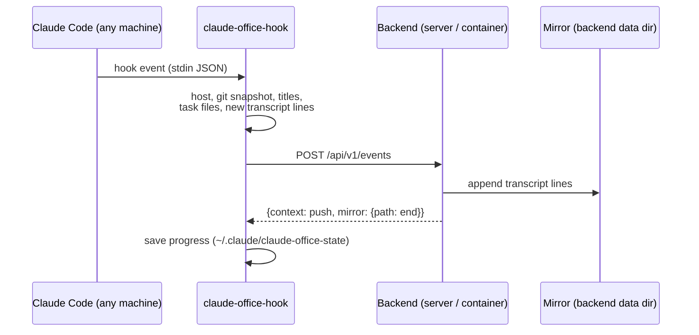

# Remote Hosts

Run one Claude Office backend and feed it from Claude Code on several machines:
a server, a WSL distro on a laptop, the Windows host of that WSL, or a backend
in a container that cannot see any of them.

## Table of Contents

- [How It Works](#how-it-works)
- [What the Hook Sends](#what-the-hook-sends)
- [Backend Setup](#backend-setup)
- [Client Setup](#client-setup)
- [Verifying](#verifying)
- [Limits](#limits)

## How It Works

The backend used to read the session's files itself: the git checkout for the
project name and branch, `~/.claude/projects/...` for titles and telemetry,
`~/.claude/tasks` for the task panel, `~/.claude/sessions` for liveness. That
only works on the same machine, outside a container.

From hooks 0.26 the hook gathers those facts where the files are and attaches
them to the event it already posts. The backend answers each event with
`context: "local"` (it can read the files itself, so the hook stops pushing)
or `context: "push"`.



A session is **local** to the backend only when its `host` (and WSL distro)
matches the backend's own. Only then does the backend open the session's paths;
a remote session's path may exist on the backend too but belong to a different
checkout, so it is never read.

## What the Hook Sends

| Field | When | Used for |
|-------|------|----------|
| `host` | every event | locality, host chip in the session list |
| `client_git` | session start, then at most every 30 s after a prompt, a stop or a file-changing tool; only when it changed | project name and grouping, branch, room git panel |
| `custom_title` / `ai_title` | when known | session name (`/rename`) and summary |
| `task_files` | when `~/.claude/tasks/<list>` changed | task panel |
| `transcript_sync` | lines appended since the last event | everything read from transcripts (telemetry estimate, reply summaries, subagent speech, tool details) |

`transcript_sync` is not the full transcript: strings are capped at 8 KB,
inline images and file-history snapshots are dropped, each hook run reads at
most 1 MB and sends at most 768 KB, and a session's first sync starts from its
last 2 MB. Status line reports also keep a remote session marked active while
it answers without firing hooks.

## Backend Setup

Nothing to configure. The mirror lives in `mirror/` next to the SQLite
database (or `CLAUDE_OFFICE_DATA_DIR`), override it with
`TRANSCRIPT_MIRROR_DIR`. Files untouched for 14 days are pruned at startup.

In Docker the `~/.claude` mount and `CLAUDE_PATH_HOST` / `CLAUDE_PATH_CONTAINER`
are no longer needed once every client runs hooks 0.26 or later. Dropping the
mount also keeps credentials in `~/.claude` out of the container.

The backend names itself after `socket.gethostname()`. Set
`CLAUDE_OFFICE_BACKEND_HOST` if Claude Code on the same machine reports a
different name (for example a backend started with a fixed container hostname
that should count as the host).

## Client Setup

On every machine that runs Claude Code:

1. Install hooks 0.26 or later and register them (`claude-office-hook install`,
   or `hooks/install.sh` from a checkout).
2. Point them at the backend in `~/.claude/claude-office-config.env`
   (`%USERPROFILE%\.claude\claude-office-config.env` on Windows):

   ```bash
   CLAUDE_OFFICE_API_URL=https://office.example.lan/api/v1/events
   CLAUDE_OFFICE_ALLOW_REMOTE=1
   CLAUDE_OFFICE_API_KEY=<the backend's CLAUDE_OFFICE_API_KEY>
   # Only when the machine does not trust the reverse proxy's CA yet:
   # CLAUDE_OFFICE_CA_FILE=~/.claude/office-root.crt
   ```

3. Optional but recommended: wrap the status line
   (`claude-office-hook wrap-statusline`) for exact model, context and cost.

A WSL distro is its own machine here: install the Linux hook inside it with
its own config file. It reaches a LAN backend directly, the WSL relay
(`CLAUDE_OFFICE_RELAY`) is only for the desktop app on the same Windows host.

## Verifying

- `~/.claude/claude-office-hooks.log` stays free of `send_event failed`
  (enable details with `CLAUDE_OFFICE_DEBUG=1`).
- `~/.claude/claude-office-state/<session>.json` shows `"mode": "push"` and
  growing `sync` offsets.
- The session list shows the repo name and a host chip; the room's git panel
  fills after the first prompt.

## Limits

- Liveness of a remote session comes from `session_end` and staleness (no
  hook event, status line report or transcript line for a while); a crashed
  terminal shows as idle rather than ended.
- Hook-pushed transcripts are trimmed, so tool details show at most 8 KB per
  string.
- Beads task tracking (`bd`) still needs the checkout on the backend machine.
